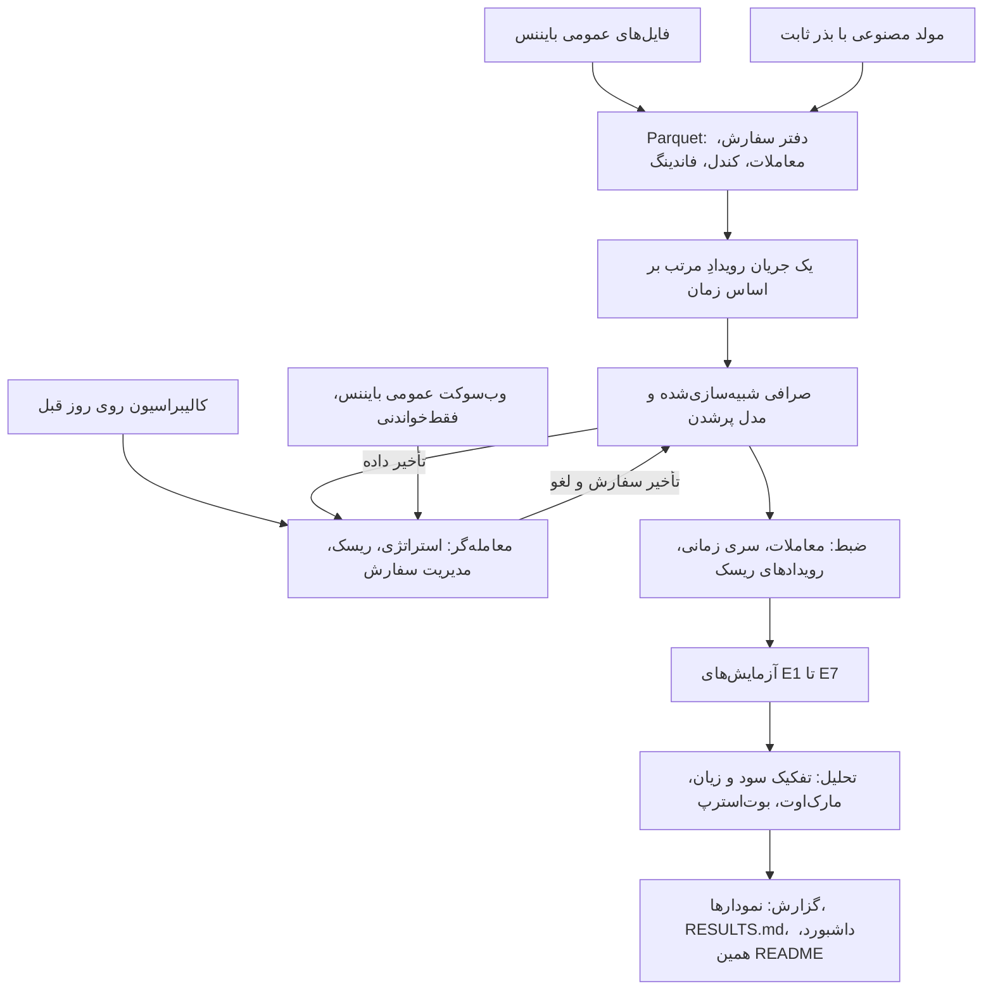

<div dir="rtl">

# QuoteLab

[English](README.md) · **فارسی**

یک شبیه‌ساز رویدادمحورِ بازارسازی (market making) به زبان پایتون، روی داده‌ی عمومی فیوچرز
USD-M بایننس (بهترین قیمت خرید و فروش و معاملات انجام‌شده برای BTCUSDT و ETHUSDT) و یک مولدِ
جریان سفارشِ مصنوعی با بذر ثابت. این پروژه یک شبیه‌سازی است برای بررسی مدل‌های کوت‌دهی،
واقع‌گرایی پرشدن سفارش‌ها و کنترل‌های ریسک. سامانه‌ی معاملاتی نیست، هیچ‌وقت سفارش واقعی ثبت
نمی‌کند، به هیچ کلید API یا حسابی نیاز ندارد و هیچ ادعای سودآوری ندارد.


این انیمیشن از فایل‌های خروجی یک بک‌تست روی داده‌ی بایننس ساخته شده است: بالا بهترین قیمت
خرید و فروش بازار (با نمونه‌برداری ثانیه‌ای) و معاملات ما، وسط موجودی (پوزیشن) و پایین سود و زیان
از ابتدای همان بازه.

## مسئله

بازارساز هم‌زمان یک قیمت خرید و یک قیمت فروش اعلام می‌کند. وقتی هر دو طرف پر شوند اسپرد را
به دست می‌آورد، و وقتی قیمت برخلاف موجودی‌ای که در دست دارد حرکت کند ضرر می‌کند. این‌که یک مدل
کوت‌دهی «کار می‌کند» یا نه، بیشتر به نحوه‌ی شبیه‌سازی پرشدن سفارش‌ها بستگی دارد تا به خود مدل:
بک‌تستی که هر سفارشی را که قیمت به آن رسید پر شده فرض کند، صف جلوی سفارش را نبیند و تأخیر را
نادیده بگیرد، می‌تواند یک استراتژی بازنده را برنده نشان دهد. پرسش QuoteLab این است که مدل‌های
کتاب‌های درسی روی داده‌ی واقعی، با احتساب کارمزد، تأخیر و تخمین جایگاه در صف، چه رفتاری دارند
و هر لایه‌ی واقع‌گرایی چه‌قدر نتیجه را عوض می‌کند.

## رویکرد

- **داده.** فایل‌های روزانه‌ی عمومی ⁦`data.binance.vision`⁩ (بهترین قیمت‌ها، معاملات، کندل‌های
  یک‌دقیقه‌ای و نرخ فاندینگ) که با چک‌سام SHA-256 بررسی و به Parquet تبدیل می‌شوند. یک مولد
  مصنوعی با همان ساختار، همه‌ی نمودارها را بدون دانلود قابل بازتولید می‌کند.
- **یک حلقه‌ی رویداد.** یک ساعت واحد، رویدادهای دفتر سفارش و معاملات را به ترتیب زمان
  بازپخش می‌کند. معامله‌گر داده را با تأخیر داده می‌بیند و سفارش‌ها و لغوهایش با تأخیر خودشان به
  صرافیِ شبیه‌سازی‌شده می‌رسند. هیچ جزئی نمی‌تواند رویدادی را پیش از زمانش بخواند.
- **مدل‌ها.** قیمت منصفانه، میکروپرایس است با یک جمله‌ی اختیاری از عدم‌توازن جریان سفارش
  (OFI). کوت‌ها از اسپرد ثابت، اسکیو بر اساس موجودی، مدل اولانه‌دا-استویکوف یا فرم بسته‌ی GLFT
  می‌آیند. نوسان و شدت پرشدن فقط روی روز قبل کالیبره می‌شوند (walk-forward).
- **پرشدن سفارش.** سه مدل پرشدن (خوش‌بینانه، عبور قیمت از سفارش، و آگاه از صف) تا اثر
  واقع‌گرایی اندازه‌گیری شود، نه این‌که فرض شود.
- **ریسک.** سقف سخت موجودی، کلیدهای توقف قفل‌شونده (موجودی، افت سرمایه، داده‌ی کهنه)،
  قطع‌کننده‌های موقت (وقفه‌ی داده، اسپرد، جهش نوسان، جریان سفارش سمی)، افزایش مرحله‌ای حجم و
  پوشش ریسک اختیاری با سفارش تیکر.
- **تحلیل.** در هر اجرا، تفکیک سود و زیان (اسپرد، موجودی، کارمزد، پوشش ریسک، فاندینگ) با ارزش
  نهایی حساب تطبیق داده می‌شود، مارک‌اوت‌ها در ۱، ۵، ۳۰ و ۶۰ ثانیه با DuckDB محاسبه می‌شوند و
  میانگین‌ها با بازه‌ی بوت‌استرپ روزانه گزارش می‌شوند.
- **آزمایش‌ها.** هفت آزمایش: نردبان واقع‌گرایی (E1)، مقایسه‌ی استراتژی‌ها (E2)، حساسیت
  پارامترها (E3)، تأخیر (E4)، رژیم‌های نوسان (E5)، مطالعه‌ی پرتلاطم‌ترین ساعت با و بدون کنترل
  ریسک (E6) و سطوح کارمزد میکر و کارمزد سربه‌سر (E7).
- **معامله‌ی کاغذی زنده.** همان استراتژی و موتور روی وب‌سوکت عمومی و فقط‌خواندنیِ بایننس
  اجرا می‌شوند و پرشدن‌ها به‌صورت محلی شبیه‌سازی می‌شود. سپس جلسه‌ی ضبط‌شده در بک‌تست بازپخش
  می‌شود تا فاصله‌ی زنده و بک‌تست اندازه‌گیری شود.

## معماری



نمودار متنی کامل‌تر با نام ماژول‌ها در [README انگلیسی](README.md#architecture) آمده است.

## اجرا

پیش‌نیاز: [uv](https://docs.astral.sh/uv/) و پایتون نسخه‌ی 3.11 یا بالاتر. این سه فرمان همه‌ی نتایج و
نمودارهای داده‌ی مصنوعی را از یک کلون تمیز دوباره می‌سازند:

```bash
make install
make backtest
make report
```

فرمان ⁦`make backtest`⁩ داده‌ی مصنوعی را می‌سازد و آزمایش‌های E1 تا E7 را اجرا می‌کند؛ فرمان
⁦`make report`⁩ پوشه‌ی ⁦`reports/synthetic/`⁩ و بلوک نتایج مصنوعی در پایین را به‌روز می‌کند. یک
فرمان دیگر همین کار را روی داده‌ی بایننس انجام می‌دهد (دانلود، تبدیل، بک‌تست و گزارش):

```bash
make real
```

فرمان ⁦`make test`⁩ آزمون‌ها را اجرا می‌کند. فرمان ⁦`make paper`⁩ یک جلسه‌ی معامله‌ی کاغذی روی فید
عمومی اجرا می‌کند (۱۵ دقیقه گرم‌کردن و سپس ۶۰ دقیقه) و آن را با بازپخشش مقایسه می‌کند.

## نتایج

همه‌ی عددهای این بخش را کد گزارش از روی فایل‌های خروجی اجراها می‌نویسد و هیچ‌کدام دستی تایپ
نشده‌اند. همه‌ی این‌ها شبیه‌سازی است و هیچ‌کدام دلیلی بر سودآوری یک استراتژی در بازار واقعی
نیست. در این نتایج، کارمزد میکرِ سربه‌سر منفی یعنی استراتژی فقط با دریافت ریبیت (کارمزد منفی)
به سربه‌سر می‌رسد.

<!-- quotelab:results:synthetic:start -->
### نتایج QuoteLab روی داده‌ی مصنوعی

- نماد ⁦SYNTHUSDT⁩، استراتژی پایه‌ی ⁦glft⁩ در 4 روز آزمون: میانگین سود و زیان روزانه ⁦-$80.70⁩، که از آن سهم اسپرد ⁦$0.69⁩، سهم موجودی ⁦-$1.14⁩ و سهم کارمزد ⁦-$80.26⁩ است. کارمزد میکرِ سربه‌سر ⁦-0.011 bps⁩.


گزارش کامل با همه‌ی جدول‌ها (به انگلیسی): [reports/synthetic/RESULTS.md](reports/synthetic/RESULTS.md)
<!-- quotelab:results:synthetic:end -->

<!-- quotelab:results:real:start -->
### نتایج QuoteLab روی داده‌ی بایننس

- نماد ⁦BTCUSDT⁩، استراتژی پایه‌ی ⁦glft⁩ در 4 روز آزمون: میانگین سود و زیان روزانه ⁦-$1,146.23⁩، که از آن سهم اسپرد ⁦$62.66⁩، سهم موجودی ⁦-$387.33⁩ و سهم کارمزد ⁦-$821.58⁩ است. کارمزد میکرِ سربه‌سر ⁦-0.790 bps⁩.
- نماد ⁦ETHUSDT⁩، استراتژی پایه‌ی ⁦glft⁩ در 4 روز آزمون: میانگین سود و زیان روزانه ⁦-$220.87⁩، که از آن سهم اسپرد ⁦$16.59⁩، سهم موجودی ⁦-$80.40⁩ و سهم کارمزد ⁦-$157.05⁩ است. کارمزد میکرِ سربه‌سر ⁦-0.813 bps⁩.


گزارش کامل با همه‌ی جدول‌ها (به انگلیسی): [reports/real/RESULTS.md](reports/real/RESULTS.md)
<!-- quotelab:results:real:end -->

<!-- quotelab:results:paper:start -->
### جلسه‌ی معامله‌ی کاغذی

- نماد ⁦BTCUSDT⁩، بازه‌ی زنده از ⁦2026-10-12 09:38⁩ تا ⁦2026-10-12 10:38⁩ به وقت UTC: سود و زیان کاغذی ⁦-$21.31⁩ با 360 معامله‌ی کوت، و بازپخش همان بازه در بک‌تست ⁦-$20.92⁩ با 352 معامله.
- فید: 1,064,730 پیام، 0 اتصال دوباره، ⁦9.58%⁩ پیام با زمانی عقب‌تر از ساعت موتور، و تأخیر میانه‌ی ⁦-284.6 ms⁩ در برابر 5 میلی‌ثانیه‌ای که موتور فرض می‌کند.


مقایسه‌ی کامل (به انگلیسی): [reports/paper/20261012T0923Z/COMPARISON.md](reports/paper/20261012T0923Z/COMPARISON.md)
<!-- quotelab:results:paper:end -->


## نقشه‌ی قابلیت‌ها

- **قیمت منصفانه:** میکروپرایس به‌علاوه‌ی جمله‌ی عدم‌توازن جریان سفارش با شیبی که روی روز قبل
  برازش شده است (⁦`strategies/signals.py`⁩، ⁦`strategies/quoting.py`⁩).
- **اسپرد و اسکیو:** اسپرد ثابت، اسکیو بر اساس موجودی، اولانه‌دا-استویکوف و GLFT
  (⁦`strategies/`⁩)؛ آزمایش E2 آن‌ها را مقایسه و E3 اسکیو را جاروب می‌کند.
- **اندازه‌ی سفارش و سقف موجودی:** اندازه بر حسب لات، سقف سخت موجودی پیش از ارسال و افزایش
  مرحله‌ای حجم (⁦`strategies/quoting.py`⁩، ⁦`risk/manager.py`⁩).
- **مارک‌اوت و انتخاب نامطلوب:** مارک‌اوت‌ها در ۱، ۵، ۳۰ و ۶۰ ثانیه با SQL در DuckDB
  (⁦`analytics/sql/markouts.sql`⁩).
- **تفکیک سود و زیان، کارمزد و نرخ پرشدن:** اسپرد، موجودی، کارمزد، پوشش ریسک و فاندینگ که در
  هر اجرا با ارزش نهایی تطبیق داده می‌شوند (⁦`analytics/attribution.py`⁩).
- **پوشش ریسک موجودی:** پوشش اختیاری با سفارش تیکر بالای یک آستانه و بستن موقعیت هنگام توقف
  (⁦`risk/manager.py`⁩).
- **بک‌تست واقع‌گرا:** تأخیرهای جداگانه‌ی داده، سفارش و لغو در یک حلقه‌ی رویداد
  (⁦`engine/backtest.py`⁩) و پرشدن آگاه از صف (⁦`fills/queue_aware.py`⁩).
- **کلید توقف و قطع‌کننده:** افزایش مرحله‌ای حجم، کلیدهای توقف قفل‌شونده و قطع‌کننده‌های موقت
  (⁦`risk/manager.py`⁩)؛ آزمایش E6 همین را می‌سنجد.
- **فاصله‌ی زنده و بک‌تست:** معامله‌ی کاغذی فقط‌خواندنی روی وب‌سوکت عمومی و بازپخش همان جلسه
  (⁦`live/`⁩).
- **پایتون تولیدی:** کلاینت وب‌سوکت با asyncio، اتصال دوباره و پایش ضربان؛ ماژول‌های کوچک و
  تایپ‌شده؛ pytest، ruff و فایل قفل uv.

## مستندات

مستندات تفصیلی به انگلیسی هستند:

- **مدل‌ها:** [docs/MODEL.md](docs/MODEL.md)، همه‌ی فرمول‌ها با جدول نمادها.
- **طراحی:** [docs/DESIGN.md](docs/DESIGN.md)، چرا رویدادمحور، جلوگیری از نگاه به آینده و
  تقریب‌های شناخته‌شده.
- **پرسش‌های مصاحبه:** [docs/INTERVIEW_NOTES.md](docs/INTERVIEW_NOTES.md).
- **نوت‌بوک:** [notebooks/quotelab.ipynb](notebooks/quotelab.ipynb)، بازسازی جدول‌ها و نمودارهای
  اصلی از فایل‌های اجرا.

## داده

```bash
make data-dry
make data
```

فرمان ⁦`make data-dry`⁩ پیش از هر دانلودی فهرست فایل‌ها، حجم هرکدام و حجم کل را نشان می‌دهد.
فرمان ⁦`make data`⁩ فایل‌ها را در ⁦`data/raw/`⁩ دانلود می‌کند، هرکدام را با چک‌سام SHA-256 منتشرشده‌ی
بایننس بررسی می‌کند و فایل‌های CSV را به Parquet در ⁦`data/processed/`⁩ تبدیل می‌کند. دانلودهای
بزرگ‌تر از سقف تنظیم‌شده بدون گزینه‌ی ⁦`--allow-large`⁩ رد می‌شوند. پوشه‌های داده و خروجی اجراها
در گیت نیستند. تاریخ‌ها و نمادها در ⁦`config/default.yaml`⁩ تنظیم می‌شوند.

## محدودیت‌ها

- **بدون عمق کامل دفتر سفارش (L2).** داده فقط بهترین قیمت‌ها و معاملات است، پس صف جلوی سفارش
  از حجم نمایش‌داده‌شده در بهترین قیمت تخمین زده می‌شود، نه این‌که دیده شود.
- **بدون اثر بازار.** سفارش‌ها و معاملات ما دفتر سفارش شبیه‌سازی‌شده را جابه‌جا نمی‌کنند.
- **فقط یک صرافی.** نه قیمت منصفانه‌ی چندصرافی، نه پوشش ریسک در صرافی دوم.
- **شبیه‌سازی، نه معامله‌ی واقعی.** حتی حالت کاغذی هم پرشدن را به‌صورت محلی شبیه‌سازی می‌کند و
  هیچ سفارشی به صرافی نمی‌رسد.
- **نمونه‌ی کوتاه.** چند روز برای هر نماد؛ بازه‌های بوت‌استرپ پهن‌اند و فقط بازه‌ای تقریبی‌اند،
  نه آزمون معناداری.
- **ثابت‌های بررسی‌نشده.** کارمزد میکر و تیکر (۲ و ۵ واحد پایه) و حداقل ارزش سفارش در
  ⁦`config/default.yaml`⁩ با جدول کارمزد فعلی بایننس تطبیق داده نشده‌اند؛ آزمایش E7 نشان می‌دهد
  نتایج با کارمزد میکر چگونه تغییر می‌کنند.
- **توصیه‌ی سرمایه‌گذاری نیست.** هیچ بخشی از این پروژه پیشنهادی برای معامله نیست.

## گام‌های بعدی با داده‌ی L2

- **صف واقعی:** دنبال‌کردن صف از داده‌ی سطح سفارش یا عمق کامل و سنجش مدل آگاه از صف با آن.
- **چند سطح قیمت:** کوت‌دادن در بیش از یک سطح و سنجش اثر عمق بر نرخ پرشدن و انتخاب نامطلوب.
- **کالیبراسیون بهتر:** برآورد شدت پرشدن از تخلیه‌ی عمق، نه از جهش‌های تیکر.
- **اثر بازار:** مدلی که سفارش‌ها و پوشش‌های بزرگ دفتر سفارش را جابه‌جا کنند.
- **نمونه‌ی بلندتر:** ماه‌های آرام و پرتلاطم، با آستانه‌های ریسک خارج از نمونه.

## واژه‌نامه

- **بازارساز (market maker):** معامله‌گری که هم‌زمان قیمت خرید و فروش اعلام می‌کند و از اسپرد
  سود می‌برد.
- **اسپرد (spread):** فاصله‌ی بهترین قیمت فروش و بهترین قیمت خرید.
- **میکر و تیکر (maker / taker):** سفارشی که در دفتر سفارش می‌نشیند میکر است و سفارشی که
  سفارش موجود را برمی‌دارد تیکر.
- **موجودی (inventory):** پوزیشنی که بازارساز پس از معاملاتش در دست دارد.
- **انتخاب نامطلوب (adverse selection):** پرشدن سفارش‌های ما درست پیش از حرکت قیمت به ضرر ما.
- **مارک‌اوت (markout):** تغییر قیمت میانه در چند ثانیه پس از هر معامله، از دید ما.
- **کارمزد میکرِ سربه‌سر:** کارمزد میکری که در آن میانگین سود و زیان روزانه صفر می‌شود.
- **بازپخش (replay):** اجرای دوباره‌ی داده‌ی ضبط‌شده در بک‌تست.

</div>
