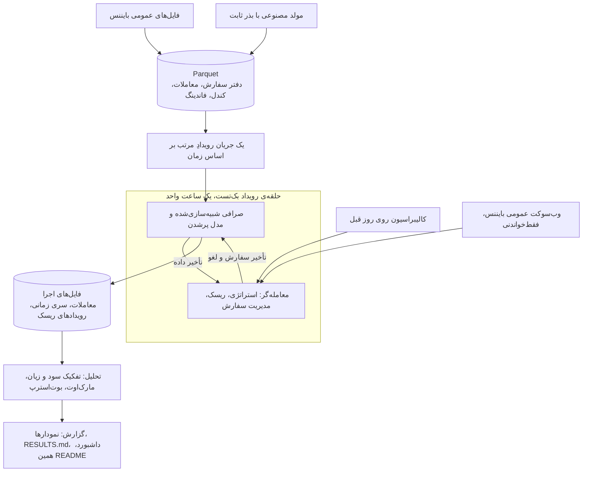

<div dir="rtl">

<div align="center">

# QuoteLab

**یک شبیه‌ساز رویدادمحورِ بازارسازی روی داده‌ی عمومی فیوچرز بایننس.**<br>
مدل‌های کوت‌دهیِ کتاب‌های درسی وقتی کارمزد، تأخیر و جایگاه در صف صادقانه شبیه‌سازی شوند چه رفتاری دارند؟

[](pyproject.toml)
[](LICENSE)
[](#داده)
[](#محدودیتها)

[English](README.md) · **فارسی**


<sub>بازپخش یک بک‌تست: پرمعامله‌ترین دقیقه‌ی یک روز آزمون ⁦BTCUSDT⁩. بالا بهترین قیمت خرید و فروش بازار با معاملات ما، وسط موجودی ما و پایین سود و زیان از ابتدای همان بازه.</sub>

</div>

> [!IMPORTANT]
> این پروژه یک شبیه‌سازی پژوهشی است. فقط داده‌ی عمومی بازار را می‌خواند، به هیچ کلید API یا
> حسابی نیاز ندارد، هیچ‌وقت سفارش واقعی ثبت نمی‌کند و هیچ ادعای سودآوری ندارد.

**فهرست:** [مسئله](#مسئله) · [نتایج کلیدی](#نتایج-کلیدی) · [اجزای پروژه](#اجزای-پروژه) · [شروع سریع](#شروع-سریع) · [معماری](#معماری) · [آزمایش‌ها](#آزمایشها) · [معامله‌ی کاغذی](#معاملهی-کاغذی-زنده) · [محدودیت‌ها](#محدودیتها)

## مسئله

بازارساز هم‌زمان یک قیمت خرید و یک قیمت فروش اعلام می‌کند. وقتی هر دو طرف پر شوند اسپرد را
به دست می‌آورد، و وقتی قیمت برخلاف موجودی‌ای که در دست دارد حرکت کند ضرر می‌کند. این‌که یک مدل
کوت‌دهی «کار می‌کند» یا نه، بیشتر به نحوه‌ی شبیه‌سازی پرشدن سفارش‌ها بستگی دارد تا به خود مدل:
بک‌تستی که هر سفارشی را که قیمت به آن رسید پر شده فرض کند، صف جلوی سفارش را نبیند و تأخیر را
نادیده بگیرد، می‌تواند یک استراتژی بازنده را برنده نشان دهد.

QuoteLab داده‌ی ⁦BTCUSDT⁩ و ⁦ETHUSDT⁩ بایننس را در یک حلقه‌ی رویداد بازپخش می‌کند و می‌سنجد هر
لایه‌ی واقع‌گرایی (کارمزد، تأخیر و تخمین جایگاه در صف) چه‌قدر نتیجه را عوض می‌کند.

## نتایج کلیدی

استراتژی پایه، کوت‌دهی GLFT با پرشدنِ آگاه از صف و تأخیر است، روی داده‌ی عمومی فیوچرز USD-M
بایننس. همه‌ی عددهای این بخش را فرمان ⁦`make report`⁩ از روی فایل‌های خروجی اجراها می‌نویسد و
هیچ‌کدام دستی تایپ نشده‌اند. همه‌ی این‌ها شبیه‌سازی است. کارمزد میکرِ سربه‌سرِ منفی یعنی
استراتژی فقط با دریافت ریبیت (کارمزد منفی) به سربه‌سر می‌رسد.

<!-- quotelab:results:real:start -->
<sub>⁦196⁩ بک‌تست روی ⁦4⁩ روز آزمون، ⁦6.0⁩ میلیارد رویداد بازار.</sub>

| نماد | میانگین سود و زیان روزانه | اسپرد | موجودی | کارمزد | کارمزد میکرِ سربه‌سر |
|---|--:|--:|--:|--:|--:|
| ⁦BTCUSDT⁩ | ⁦-$1,146.23⁩ | ⁦$62.66⁩ | ⁦-$387.33⁩ | ⁦-$821.58⁩ | ⁦-0.79 bps⁩ |
| ⁦ETHUSDT⁩ | ⁦-$220.87⁩ | ⁦$16.59⁩ | ⁦-$80.40⁩ | ⁦-$157.05⁩ | ⁦-0.81 bps⁩ |

- **واقع‌گرایی پرشدن سفارش.** میانگین سود و زیان روزانه از پرشدن ⁦optimistic⁩ تا پرشدن با صف و تأخیر (⁦queue_latency⁩): ⁦BTCUSDT⁩ از ⁦-$907.62⁩ به ⁦-$1,146.23⁩؛ ⁦ETHUSDT⁩ از ⁦-$176.13⁩ به ⁦-$220.87⁩.
- **کارمزد.** استراتژی پایه فقط با ریبیت میکر سربه‌سر می‌شود: ⁦BTCUSDT⁩ ⁦-0.79 bps⁩، ⁦ETHUSDT⁩ ⁦-0.81 bps⁩.

**نردبان واقع‌گرایی (E1).** سود و زیان روزانه‌ی استراتژی پایه وقتی مدل پرشدن سفارش پله‌پله واقع‌گرایانه‌تر می‌شود، در کنار همان سود و زیان پیش از کارمزد میکر.


**مقایسه‌ی استراتژی‌ها (E2).** سود و زیان روزانه‌ی هر مدل کوت‌دهی به تفکیک اسپرد، موجودی، کارمزد، پوشش ریسک و فاندینگ؛ لوزی سیاه مجموع است.


**سطوح کارمزد (E7).** سود و زیان روزانه‌ی استراتژی پایه در هر سطح کارمزد میکر؛ کارمزد سربه‌سر جایی است که خط از صفر می‌گذرد.


گزارش کامل با همه‌ی جدول‌ها (به انگلیسی): [reports/real/RESULTS.md](reports/real/RESULTS.md)
<!-- quotelab:results:real:end -->

<details>
<summary><b>همین آزمایش‌ها روی داده‌ی مصنوعی</b>، قابل بازتولید بدون هیچ دانلودی</summary>

<!-- quotelab:results:synthetic:start -->
<sub>⁦98⁩ بک‌تست روی ⁦4⁩ روز آزمون، ⁦4.0⁩ میلیون رویداد بازار.</sub>

| نماد | میانگین سود و زیان روزانه | اسپرد | موجودی | کارمزد | کارمزد میکرِ سربه‌سر |
|---|--:|--:|--:|--:|--:|
| ⁦SYNTHUSDT⁩ | ⁦-$80.70⁩ | ⁦$0.69⁩ | ⁦-$1.14⁩ | ⁦-$80.26⁩ | ⁦-0.01 bps⁩ |

- **واقع‌گرایی پرشدن سفارش.** میانگین سود و زیان روزانه از پرشدن ⁦optimistic⁩ تا پرشدن با صف و تأخیر (⁦queue_latency⁩): ⁦SYNTHUSDT⁩ از ⁦-$289.49⁩ به ⁦-$80.70⁩.
- **کارمزد.** استراتژی پایه فقط با ریبیت میکر سربه‌سر می‌شود: ⁦SYNTHUSDT⁩ ⁦-0.01 bps⁩.

**نردبان واقع‌گرایی (E1).** سود و زیان روزانه‌ی استراتژی پایه وقتی مدل پرشدن سفارش پله‌پله واقع‌گرایانه‌تر می‌شود، در کنار همان سود و زیان پیش از کارمزد میکر.


**مقایسه‌ی استراتژی‌ها (E2).** سود و زیان روزانه‌ی هر مدل کوت‌دهی به تفکیک اسپرد، موجودی، کارمزد، پوشش ریسک و فاندینگ؛ لوزی سیاه مجموع است.


**سطوح کارمزد (E7).** سود و زیان روزانه‌ی استراتژی پایه در هر سطح کارمزد میکر؛ کارمزد سربه‌سر جایی است که خط از صفر می‌گذرد.


گزارش کامل با همه‌ی جدول‌ها (به انگلیسی): [reports/synthetic/RESULTS.md](reports/synthetic/RESULTS.md)
<!-- quotelab:results:synthetic:end -->

</details>

فرمان ⁦`make report`⁩ هر گزارش را به شکل یک صفحه‌ی HTML هم می‌نویسد:


## اجزای پروژه

<table>
<tr>
<td width="50%" valign="top">

**موتور رویدادمحور**<br>
یک ساعت واحد، رویدادهای دفتر سفارش و معاملات را به ترتیب زمان بازپخش می‌کند. معامله‌گر داده را
با تأخیر داده می‌بیند و سفارش‌ها و لغوهایش با تأخیر خودشان به صرافیِ شبیه‌سازی‌شده می‌رسند.

</td>
<td width="50%" valign="top">

**سه مدل پرشدن**<br>
خوش‌بینانه، عبور قیمت از سفارش، و آگاه از صف با تخمین جایگاه در صف؛ تا اثر واقع‌گرایی
اندازه‌گیری شود، نه این‌که فرض شود.

</td>
</tr>
<tr>
<td valign="top">

**مدل‌های کوت‌دهی**<br>
اسپرد ثابت، اسکیو بر اساس موجودی، اولانه‌دا-استویکوف و GLFT، حول قیمت منصفانه‌ی میکروپرایس با
جمله‌ای از عدم‌توازن جریان سفارش.

</td>
<td valign="top">

**کالیبراسیون رو به جلو**<br>
نوسان و شدت پرشدن ⁦`A·exp(−k·δ)`⁩ فقط روی روز قبل برازش می‌شوند، پس هیچ روز آزمونی داده‌ی
خودش را نمی‌بیند.

</td>
</tr>
<tr>
<td valign="top">

**لایه‌ی ریسک**<br>
سقف سخت موجودی، کلیدهای توقف قفل‌شونده، قطع‌کننده‌های موقت، افزایش مرحله‌ای حجم و پوشش ریسک
اختیاری با سفارش تیکر.

</td>
<td valign="top">

**تحلیل**<br>
تفکیک سود و زیان که در هر اجرا با ارزش نهایی حساب تطبیق داده می‌شود، مارک‌اوت از ۱ تا ۶۰ ثانیه
با DuckDB و بازه‌های بوت‌استرپ روزانه.

</td>
</tr>
<tr>
<td valign="top">

**معامله‌ی کاغذی زنده**<br>
همان موتور روی وب‌سوکت عمومی و فقط‌خواندنیِ بایننس، و سپس بازپخش جلسه‌ی ضبط‌شده برای سنجش
فاصله‌ی زنده و بک‌تست.

</td>
<td valign="top">

**گزارش‌های خودکار**<br>
نمودارها، ⁦`RESULTS.md`⁩، یک داشبورد HTML و عددهای همین README، همه از روی فایل‌های اجرا.

</td>
</tr>
</table>

## شروع سریع

پیش‌نیاز: [uv](https://docs.astral.sh/uv/) و پایتون نسخه‌ی 3.11 یا بالاتر. این سه فرمان همه‌ی نتایج و
نمودارهای داده‌ی مصنوعی را از یک کلون تمیز دوباره می‌سازند:

```bash
make install
make backtest
make report
```

| فرمان | کار |
|---|---|
| ⁦`make install`⁩ | ساخت محیط از روی فایل قفل |
| ⁦`make backtest`⁩ | ساخت داده‌ی مصنوعی با بذر ثابت و اجرای آزمایش‌های E1 تا E7 |
| ⁦`make report`⁩ | نوشتن ⁦`reports/synthetic/`⁩ و به‌روزکردن بلوک نتایج مصنوعی |
| ⁦`make real`⁩ | همین کار روی داده‌ی بایننس: دانلود، بررسی، تبدیل، بک‌تست و گزارش |
| ⁦`make paper`⁩ | یک جلسه‌ی معامله‌ی کاغذی روی فید عمومی و سپس بازپخش آن |
| ⁦`make test`⁩ | اجرای آزمون‌ها |

## معماری



نمودار متنی کامل‌تر با نام ماژول‌ها در [README انگلیسی](README.md#architecture) آمده است.

## آزمایش‌ها

| | پرسش | چه چیزی تغییر می‌کند |
|---|---|---|
| **E1** | واقع‌گرایی پرشدن سفارش چه‌قدر سود و زیان را عوض می‌کند؟ | مدل پرشدن و تأخیر، پنج پله |
| **E2** | کدام مدل کوت‌دهی بهتر است و سود و زیانش از کجا می‌آید؟ | استراتژی |
| **E3** | استراتژی پایه چه‌قدر به تنظیماتش حساس است؟ | اسکیو، اندازه‌ی سفارش، سقف موجودی |
| **E4** | تأخیر چه هزینه‌ای دارد؟ | تأخیر سفارش |
| **E5** | کدام استراتژی‌ها با بالا رفتن نوسان آسیب می‌بینند؟ | ساعت‌های کم‌نوسان و پرنوسان |
| **E6** | آیا کنترل‌های ریسک در پرتلاطم‌ترین ساعت کمک می‌کنند؟ | کنترل ریسک خاموش و روشن |
| **E7** | استراتژی پایه با چه کارمزد میکری سربه‌سر می‌شود؟ | کارمزد میکر |

جدول‌ها، نمودارها و شرح هر آزمایش (به انگلیسی) در [reports/real/RESULTS.md](reports/real/RESULTS.md) آمده است.

## معامله‌ی کاغذی زنده

فرمان ⁦`make paper`⁩ همان استراتژی و موتور را روی وب‌سوکت عمومی و فقط‌خواندنیِ بایننس اجرا می‌کند
(۱۵ دقیقه گرم‌کردن و سپس ۶۰ دقیقه) و پرشدن‌ها را به‌صورت محلی شبیه‌سازی می‌کند. سپس فید ضبط‌شده در
بک‌تست بازپخش و دو نتیجه معامله‌به‌معامله مقایسه می‌شوند. آخرین جلسه:

<!-- quotelab:results:paper:start -->
نماد ⁦BTCUSDT⁩، بازه‌ی زنده از ⁦2026-10-12 09:38⁩ تا ⁦2026-10-12 10:38⁩ به وقت UTC.

| | معامله‌ی کاغذی (فید زنده) | بازپخش (بک‌تست) |
|---|--:|--:|
| سود و زیان | ⁦-$21.31⁩ | ⁦-$20.92⁩ |
| معامله‌های کوت | ⁦360⁩ | ⁦352⁩ |

- **فید.** ⁦1,064,730⁩ پیام، ⁦0⁩ اتصال دوباره، ⁦9.58%⁩ پیام با زمانی عقب‌تر از ساعت موتور، و تأخیر میانه‌ی ⁦-284.6 ms⁩ در برابر ⁦5 ms⁩ که موتور فرض می‌کند.


مقایسه‌ی کامل (به انگلیسی): [reports/paper/20261012T0923Z/COMPARISON.md](reports/paper/20261012T0923Z/COMPARISON.md)
<!-- quotelab:results:paper:end -->

## نقشه‌ی قابلیت‌ها

<details>
<summary>هر بخش QuoteLab کدام مسئولیت بازارسازی را پوشش می‌دهد</summary>

- **قیمت منصفانه:** میکروپرایس به‌علاوه‌ی جمله‌ی عدم‌توازن جریان سفارش با شیبی که روی روز قبل
  برازش شده است (⁦`strategies/signals.py`⁩، ⁦`strategies/quoting.py`⁩).
- **اسپرد و اسکیو:** اسپرد ثابت، اسکیو بر اساس موجودی، اولانه‌دا-استویکوف و GLFT
  (⁦`strategies/`⁩)؛ آزمایش E2 آن‌ها را مقایسه و E3 اسکیو را جاروب می‌کند.
- **اندازه‌ی سفارش و سقف موجودی:** اندازه بر حسب لات، سقف سخت موجودی پیش از ارسال و افزایش
  مرحله‌ای حجم (⁦`strategies/quoting.py`⁩، ⁦`risk/manager.py`⁩).
- **مارک‌اوت و انتخاب نامطلوب:** مارک‌اوت‌ها در ۱، ۵، ۳۰ و ۶۰ ثانیه با SQL در DuckDB
  (⁦`analytics/sql/markouts.sql`⁩).
- **تفکیک سود و زیان، کارمزد و نرخ پرشدن:** اسپرد، موجودی، کارمزد، پوشش ریسک و فاندینگ که در
  هر اجرا با ارزش نهایی تطبیق داده می‌شوند (⁦`analytics/attribution.py`⁩).
- **پوشش ریسک موجودی:** پوشش اختیاری با سفارش تیکر بالای یک آستانه و بستن موقعیت هنگام توقف
  (⁦`risk/manager.py`⁩).
- **بک‌تست واقع‌گرا:** تأخیرهای جداگانه‌ی داده، سفارش و لغو در یک حلقه‌ی رویداد
  (⁦`engine/backtest.py`⁩) و پرشدن آگاه از صف (⁦`fills/queue_aware.py`⁩).
- **کلید توقف و قطع‌کننده:** افزایش مرحله‌ای حجم، کلیدهای توقف قفل‌شونده و قطع‌کننده‌های موقت
  (⁦`risk/manager.py`⁩)؛ آزمایش E6 همین را می‌سنجد.
- **فاصله‌ی زنده و بک‌تست:** معامله‌ی کاغذی فقط‌خواندنی روی وب‌سوکت عمومی و بازپخش همان جلسه
  (⁦`live/`⁩).
- **پایتون تولیدی:** کلاینت وب‌سوکت با asyncio، اتصال دوباره و پایش ضربان؛ ماژول‌های کوچک و
  تایپ‌شده؛ pytest، ruff و فایل قفل uv.

</details>

## مستندات

مستندات تفصیلی به انگلیسی هستند:

| سند | محتوا |
|---|---|
| [docs/MODEL.md](docs/MODEL.md) | همه‌ی فرمول‌ها با جدول نمادها |
| [docs/DESIGN.md](docs/DESIGN.md) | چرا رویدادمحور، جلوگیری از نگاه به آینده و تقریب‌های شناخته‌شده |
| [docs/INTERVIEW_NOTES.md](docs/INTERVIEW_NOTES.md) | پرسش‌های مصاحبه با پاسخ از روی همین کد |
| [notebooks/quotelab.ipynb](notebooks/quotelab.ipynb) | بازسازی جدول‌ها و نمودارهای اصلی از فایل‌های اجرا |

## داده

```bash
make data-dry
make data
```

فرمان ⁦`make data-dry`⁩ پیش از هر دانلودی فهرست فایل‌ها، حجم هرکدام و حجم کل را نشان می‌دهد.

<details>
<summary>فرمان ⁦<code>make data</code>⁩ چه می‌کند</summary>

فایل‌ها را در ⁦`data/raw/`⁩ دانلود می‌کند، هرکدام را با چک‌سام SHA-256 منتشرشده‌ی بایننس بررسی
می‌کند و فایل‌های CSV را به Parquet در ⁦`data/processed/`⁩ تبدیل می‌کند. دانلودهای بزرگ‌تر از سقف
تنظیم‌شده بدون گزینه‌ی ⁦`--allow-large`⁩ رد می‌شوند. پوشه‌های داده و خروجی اجراها در گیت نیستند.
تاریخ‌ها و نمادها در ⁦`config/default.yaml`⁩ تنظیم می‌شوند.

</details>

## محدودیت‌ها

- **بدون عمق کامل دفتر سفارش (L2).** داده فقط بهترین قیمت‌ها و معاملات است، پس صف جلوی سفارش
  از حجم نمایش‌داده‌شده در بهترین قیمت تخمین زده می‌شود، نه این‌که دیده شود.
- **بدون اثر بازار.** سفارش‌ها و معاملات ما دفتر سفارش شبیه‌سازی‌شده را جابه‌جا نمی‌کنند.
- **فقط یک صرافی.** نه قیمت منصفانه‌ی چندصرافی، نه پوشش ریسک در صرافی دوم.
- **شبیه‌سازی، نه معامله‌ی واقعی.** حتی حالت کاغذی هم پرشدن را به‌صورت محلی شبیه‌سازی می‌کند و
  هیچ سفارشی به صرافی نمی‌رسد.
- **نمونه‌ی کوتاه.** چند روز برای هر نماد؛ بازه‌های بوت‌استرپ پهن‌اند و فقط بازه‌ای تقریبی‌اند،
  نه آزمون معناداری.
- **ثابت‌های بررسی‌نشده.** کارمزد میکر و تیکر (۲ و ۵ واحد پایه) و حداقل ارزش سفارش در
  ⁦`config/default.yaml`⁩ با جدول کارمزد فعلی بایننس تطبیق داده نشده‌اند؛ آزمایش E7 نشان می‌دهد
  نتایج با کارمزد میکر چگونه تغییر می‌کنند.
- **توصیه‌ی سرمایه‌گذاری نیست.** هیچ بخشی از این پروژه پیشنهادی برای معامله نیست.

## گام‌های بعدی با داده‌ی L2

- **صف واقعی:** دنبال‌کردن صف از داده‌ی سطح سفارش یا عمق کامل و سنجش مدل آگاه از صف با آن.
- **چند سطح قیمت:** کوت‌دادن در بیش از یک سطح و سنجش اثر عمق بر نرخ پرشدن و انتخاب نامطلوب.
- **کالیبراسیون بهتر:** برآورد شدت پرشدن از تخلیه‌ی عمق، نه از جهش‌های تیکر.
- **اثر بازار:** مدلی که سفارش‌ها و پوشش‌های بزرگ دفتر سفارش را جابه‌جا کنند.
- **نمونه‌ی بلندتر:** ماه‌های آرام و پرتلاطم، با آستانه‌های ریسک خارج از نمونه.

<details>
<summary><b>واژه‌نامه</b></summary>

- **بازارساز (market maker):** معامله‌گری که هم‌زمان قیمت خرید و فروش اعلام می‌کند و از اسپرد
  سود می‌برد.
- **اسپرد (spread):** فاصله‌ی بهترین قیمت فروش و بهترین قیمت خرید.
- **میکر و تیکر (maker / taker):** سفارشی که در دفتر سفارش می‌نشیند میکر است و سفارشی که
  سفارش موجود را برمی‌دارد تیکر.
- **موجودی (inventory):** پوزیشنی که بازارساز پس از معاملاتش در دست دارد.
- **انتخاب نامطلوب (adverse selection):** پرشدن سفارش‌های ما درست پیش از حرکت قیمت به ضرر ما.
- **مارک‌اوت (markout):** تغییر قیمت میانه در چند ثانیه پس از هر معامله، از دید ما.
- **کارمزد میکرِ سربه‌سر:** کارمزد میکری که در آن میانگین سود و زیان روزانه صفر می‌شود.
- **بازپخش (replay):** اجرای دوباره‌ی داده‌ی ضبط‌شده در بک‌تست.

</details>

## مجوز

مجوز این پروژه [MIT](LICENSE) است.

</div>
