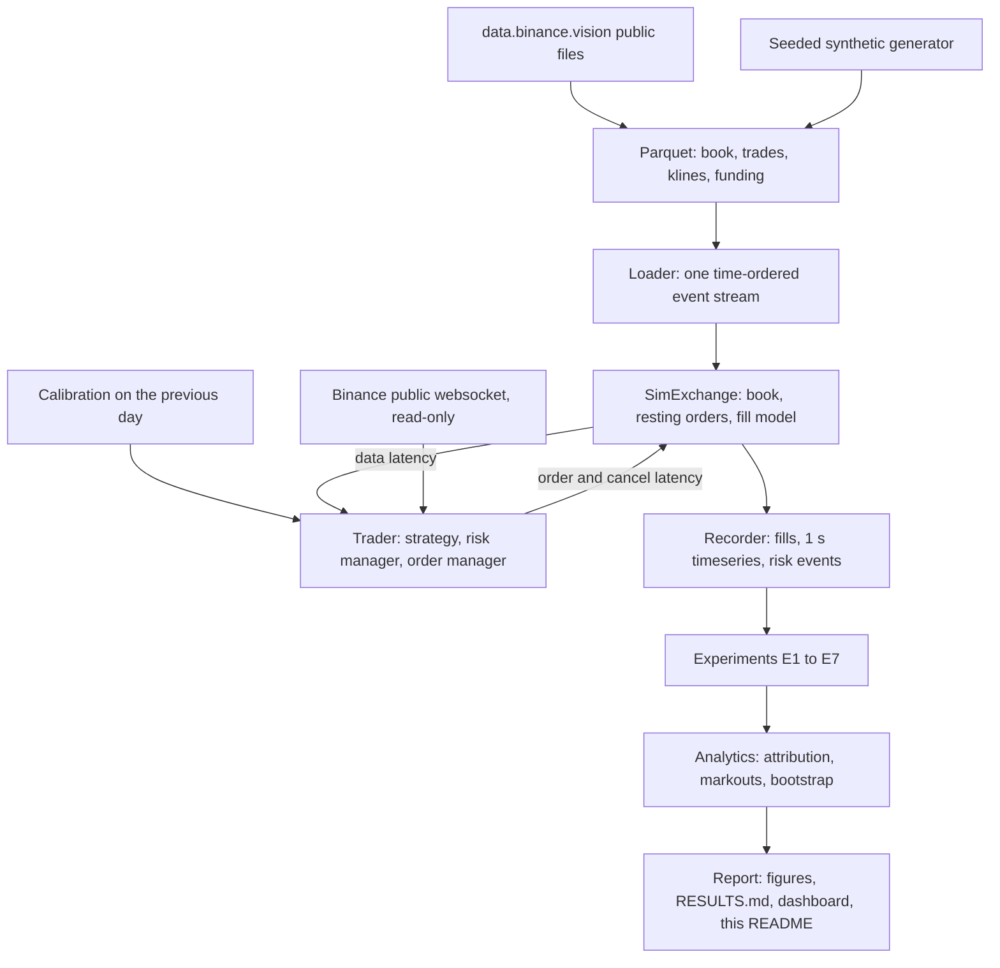
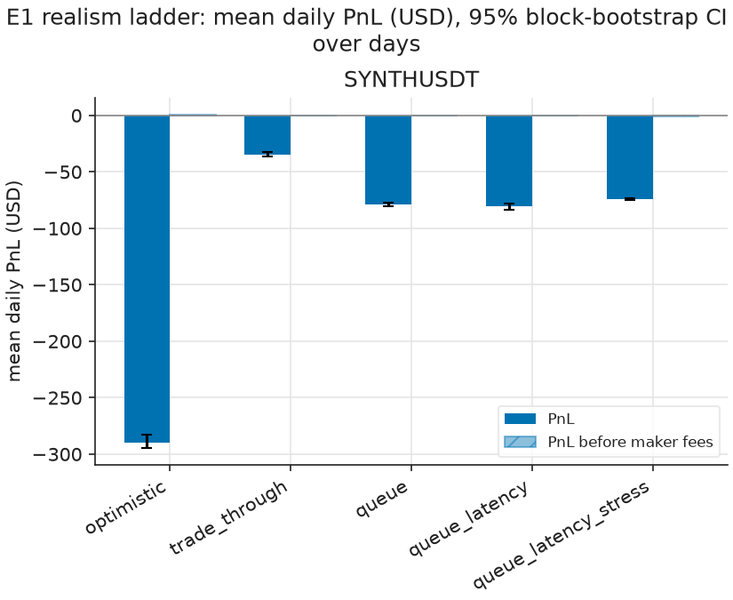
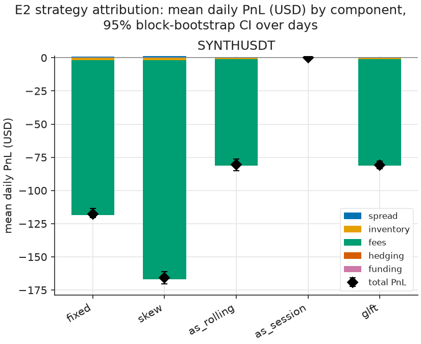
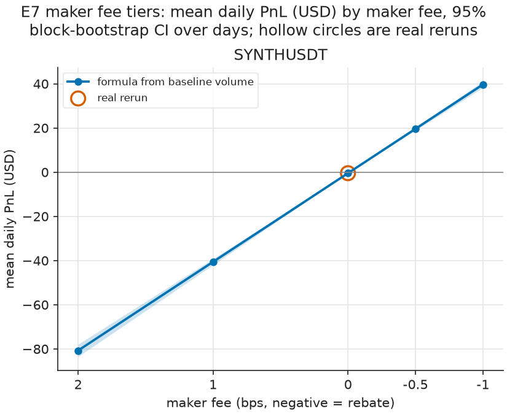
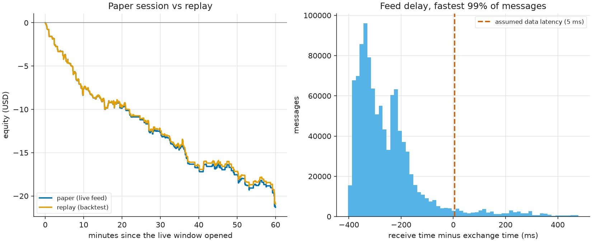
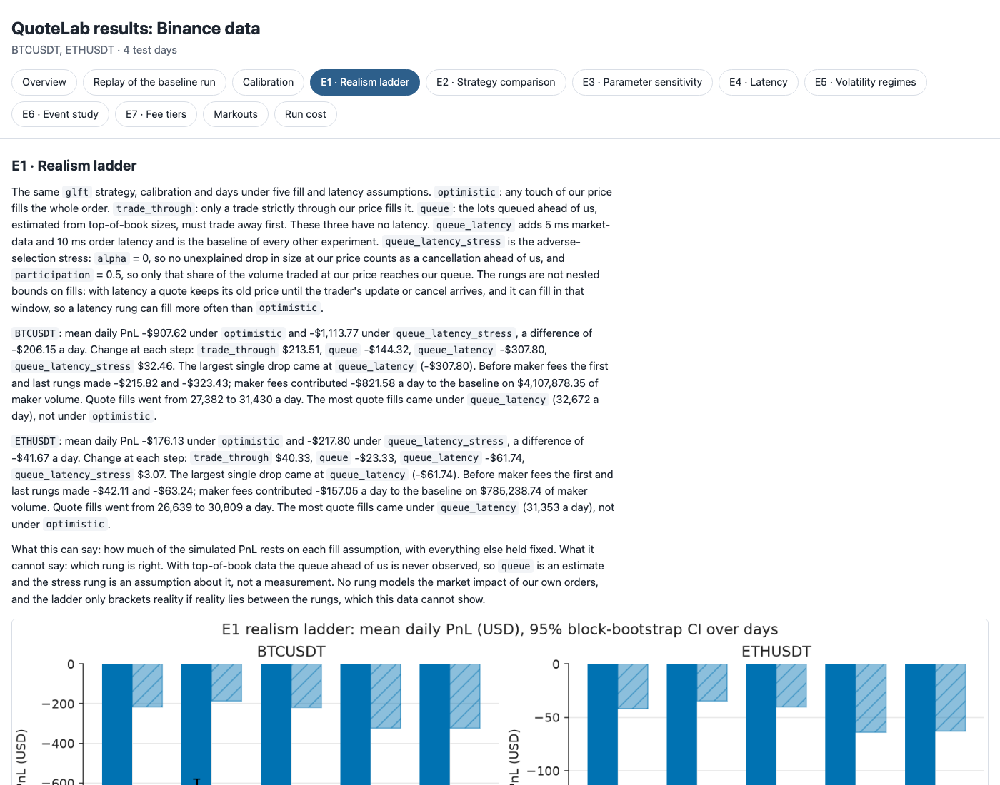

# QuoteLab

**English** · [فارسی](README.fa.md)

An event-driven market-making simulator in Python, built on public Binance USD-M futures data
(top of book and trade prints for BTCUSDT and ETHUSDT) and a seeded synthetic order-flow
generator. It is a simulation for studying quoting models, fill realism and risk controls. It is
not a trading system, it never places an order, and it makes no claim of profitability.


A replay drawn from the files of one backtest run on Binance data: the market's best bid and ask
(sampled once a second) with our fills on top, our position in the middle and the PnL since the
window opened at the bottom.

## Problem

A market maker quotes a bid and an ask, earns the spread when both sides fill, and loses when
the price moves against the inventory it is left holding. Whether a quoting model "works"
depends less on the model than on how fills are simulated: a backtest that fills every order
touched by the price, ignores the queue ahead of you and ignores latency can turn a losing
strategy into a winning one. QuoteLab asks how textbook quoting models behave on real public
data once fees, latency and an estimated queue position are included, and how much each layer
of realism changes the answer.

## Approach

- **Data.** Public daily files from `data.binance.vision` (best bid/offer, individual trades,
  1-minute klines, funding), checksum-verified and converted to Parquet. A seeded synthetic
  generator with the same schema makes every figure reproducible without a download.
- **One event loop.** A single clock replays book and trade events in time order. The trader
  sees data after a data latency; its orders and cancels reach the simulated exchange after
  their own latencies. Nothing can read an event before its timestamp.
- **Models.** Fair value is the microprice with an optional order-flow-imbalance term. Quotes
  come from a fixed spread, an inventory skew, Avellaneda-Stoikov, or the GLFT closed form.
  Volatility and the fill intensity `A·exp(−k·δ)` are calibrated on the previous day only
  (walk-forward).
- **Fills.** Three fill models (optimistic, trade-through, queue-aware) so the effect of fill
  realism is measured rather than assumed.
- **Risk.** Hard inventory bound, latched kill switches (inventory, drawdown, stale data),
  temporary circuit breakers (data gap, spread, volatility spike, order-flow toxicity), a staged
  size ramp, and an optional taker hedge.
- **Analysis.** Every run reconciles a PnL attribution (spread, inventory, fees, hedging,
  funding) to the engine's final equity, computes markouts at 1, 5, 30 and 60 seconds in
  DuckDB, and reports means with day-level bootstrap intervals.
- **Experiments.** E1 realism ladder, E2 strategy comparison, E3 parameter sensitivity, E4
  latency sweep, E5 volatility regimes, E6 event study of the most violent hour with risk
  controls off and on, E7 maker-fee tiers and the break-even fee.
- **Live paper mode.** The same strategy and engine run on Binance's public, read-only
  websocket, with fills simulated locally. The recorded session is then replayed through the
  backtest to measure the live-versus-backtest gap.

## Architecture



The same flow with module names:

```text
 data.binance.vision (public files)             synthetic generator (seeded)
        │ download, SHA-256 check, convert                │
        ▼                                                 ▼
  data/processed/*.parquet   (book, trades, klines, funding; real units, ts in ns)
        │
        ▼
  loader ── one time-ordered event stream (ts, kind, row)
        │                        calibration on the previous day: σ, A, k, OFI β, γ
        ▼                                         │
 ┌─────────────────────── Backtest event loop (one clock) ───────────────────────┐
 │                                                                                │
 │  market event ──▶ SimExchange: book, resting orders, fill model                │
 │       │           (optimistic | trade-through | queue-aware)                   │
 │       │ data latency                         ▲ order / cancel latency          │
 │       ▼                                      │                                 │
 │  Trader: Strategy (fixed | skew | A-S | GLFT) ─▶ RiskManager ─▶ OrderManager   │
 │          Portfolio: cash, position, fees, funding                              │
 │                                                                                │
 └───────────────────────────────────┬────────────────────────────────────────────┘
                                     │ Recorder: fills, 1 s timeseries, risk events
                                     ▼
  experiments E1–E7 (process pool) ──▶ runs/<dataset>/*.parquet
                                     ▼
  analytics: attribution + reconciliation, markouts (DuckDB SQL), bootstrap intervals
                                     ▼
  report: figures, RESULTS.md, dashboard.html, the results blocks in this README

  live/paper_runner.py: public websocket (asyncio, read-only, reconnect, heartbeat)
        ──▶ the same Backtest loop, fed message by message ──▶ runs/paper/<session>/
        ──▶ paper-compare: replay the recorded feed, compare fills, PnL and risk events
```

## How to run

Requires [uv](https://docs.astral.sh/uv/) and Python 3.11 or later. Three commands rebuild every
synthetic result and figure from a clean clone:

```bash
make install
make backtest
make report
```

`make backtest` writes the synthetic dataset and runs E1 to E7; `make report` writes
`reports/synthetic/` and refreshes the synthetic block below. One extra command does the same
on Binance data (download, convert, backtest and report):

```bash
make real
```

`make test` runs the test suite. `make paper` runs a live paper session on the public feed
(15 minutes of warm-up, then 60 minutes) and compares it with its replay.

## Results

Every number in this section is written by the report code from files a run produced. Nothing
here is typed by hand. All of it is simulation: none of it is evidence that a strategy would
make money live.

<!-- quotelab:results:synthetic:start -->
### QuoteLab results: synthetic data

- `SYNTHUSDT`, baseline `glft` over 4 test days: mean daily PnL -$80.70, of which spread $0.69, inventory -$1.14 and fees -$80.26. Break-even maker fee -0.011 bps.

**E1 realism ladder (USD per day)**

| Rung | Symbol | Mean daily PnL [95% CI] | Change vs previous rung |
|---|---|---|---|
| optimistic | SYNTHUSDT | -289.49 [-294.52, -282.39] | n/a |
| trade_through | SYNTHUSDT | -34.52 [-36.52, -32.52] | 254.97 |
| queue | SYNTHUSDT | -78.62 [-80.33, -76.92] | -44.10 |
| queue_latency | SYNTHUSDT | -80.70 [-83.49, -77.91] | -2.08 |
| queue_latency_stress | SYNTHUSDT | -74.26 [-75.30, -73.27] | 6.44 |







Full write-up with every table: [reports/synthetic/RESULTS.md](reports/synthetic/RESULTS.md). The same report as a page to open locally: `reports/synthetic/dashboard.html`.
<!-- quotelab:results:synthetic:end -->

<!-- quotelab:results:real:start -->
### QuoteLab results: Binance data

- `BTCUSDT`, baseline `glft` over 4 test days: mean daily PnL -$1,146.23, of which spread $62.66, inventory -$387.33 and fees -$821.58. Break-even maker fee -0.790 bps.
- `ETHUSDT`, baseline `glft` over 4 test days: mean daily PnL -$220.87, of which spread $16.59, inventory -$80.40 and fees -$157.05. Break-even maker fee -0.813 bps.

**E1 realism ladder (USD per day)**

| Rung | Symbol | Mean daily PnL [95% CI] | Change vs previous rung |
|---|---|---|---|
| optimistic | BTCUSDT | -907.62 [-1,007.89, -761.22] | n/a |
| trade_through | BTCUSDT | -694.11 [-779.29, -580.08] | 213.51 |
| queue | BTCUSDT | -838.43 [-936.37, -704.16] | -144.32 |
| queue_latency | BTCUSDT | -1,146.23 [-1,268.42, -1,003.59] | -307.80 |
| queue_latency_stress | BTCUSDT | -1,113.77 [-1,240.42, -975.05] | 32.46 |
| optimistic | ETHUSDT | -176.13 [-193.26, -159.00] | n/a |
| trade_through | ETHUSDT | -135.80 [-149.32, -122.28] | 40.33 |
| queue | ETHUSDT | -159.13 [-176.23, -142.03] | -23.33 |
| queue_latency | ETHUSDT | -220.87 [-235.94, -208.18] | -61.74 |
| queue_latency_stress | ETHUSDT | -217.80 [-232.46, -204.62] | 3.07 |


Full write-up with every table: [reports/real/RESULTS.md](reports/real/RESULTS.md). The same report as a page to open locally: `reports/real/dashboard.html`.

**Resume line:** Built QuoteLab, an event-driven market-making simulator in Python (asyncio, DuckDB, polars) with GLFT and Avellaneda-Stoikov quoting, a queue-aware fill model with latency, PnL attribution, markouts, kill switches and a read-only live paper-trading mode; ran 196 backtests over 4 test days of Binance BTCUSDT/ETHUSDT data (6.0 billion market events replayed in total) and found the baseline breaks even only with a maker rebate (break-even maker fee BTCUSDT -0.79 bps, ETHUSDT -0.81 bps).
<!-- quotelab:results:real:end -->

<!-- quotelab:results:paper:start -->
### QuoteLab paper session

- `BTCUSDT`, live window 2026-10-12 09:38 to 2026-10-12 10:38 UTC: paper PnL -$21.31 with 360 quote fills, replay -$20.92 with 352. The first 14 fills match exactly; fill 15 differs: paper buy 0.003 at 83,397.40, 60.510 s into the window, replay buy 0.003 at 83,403.80, 60.009 s into the window.
- Feed: 1,064,730 messages, 0 reconnects, 9.58% clamped, median delay -284.6 ms against the 5 ms the engine assumes.



Full comparison: [reports/paper/20261012T0923Z/COMPARISON.md](reports/paper/20261012T0923Z/COMPARISON.md).
<!-- quotelab:results:paper:end -->

`make report` also writes each report as a single HTML page. The Binance one:



## Feature map

How each part of QuoteLab maps to a market-making responsibility.

| Responsibility | Where it lives |
|---|---|
| Fair value | Microprice plus an order-flow-imbalance term with a slope fitted on the previous day (`strategies/signals.py`, `strategies/quoting.py`) |
| Spreads and skew | Fixed and inventory-skew baselines, Avellaneda-Stoikov, and GLFT with γ solved from a skew target (`strategies/`); E2 compares them, E3 sweeps the skew |
| Order sizing and inventory limits | Order size in lots, a hard inventory bound applied before sending, a staged size ramp (`strategies/quoting.py`, `risk/manager.py`); E3 sweeps size and the bound |
| Markouts and adverse selection | Markouts and adverse-selection markouts at 1, 5, 30 and 60 s in DuckDB SQL (`analytics/sql/markouts.sql`) |
| PnL attribution, fees and fill rates | Spread, inventory, fees, hedging and funding, reconciled to final equity on every run (`analytics/attribution.py`); fill rate per order sent; E7 fee tiers and break-even maker fee |
| Hedging and inventory risk | Optional taker hedge above a threshold and flatten-on-kill (`risk/manager.py`); inventory PnL attributed separately |
| Realistic backtests: fees, latency, queue position | Separate data, order and cancel latencies in one event loop (`engine/backtest.py`); queue-aware fills (`fills/queue_aware.py`); E1 realism ladder, E4 latency sweep |
| Staged rollouts, kill switches, circuit breakers | Size ramp, latched kill switches and temporary breakers (`risk/manager.py`); E6 event study with risk controls off and on |
| Live-versus-backtest gaps | Read-only paper trading on the public websocket and a replay of the same session (`live/`) that reports where fills and PnL differ |
| Production Python | asyncio websocket client with reconnect, backoff and a heartbeat watchdog; typed, small modules; pytest suite; ruff; uv lockfile; data and run outputs kept out of version control |

## Documents

- [docs/MODEL.md](docs/MODEL.md): every formula, with a notation table and a derivation sketch.
- [docs/DESIGN.md](docs/DESIGN.md): why event-driven, how look-ahead is prevented, how fills are
  modelled, and the known approximations.
- [docs/INTERVIEW_NOTES.md](docs/INTERVIEW_NOTES.md): likely interview questions with answers
  drawn from this code, and a glossary.
- [notebooks/quotelab.ipynb](notebooks/quotelab.ipynb): rebuilds the key tables and figures of one dataset from its run files.

## Data

```bash
make data-dry
make data
```

`make data-dry` lists every file with its remote size and the total before anything is fetched.
`make data` downloads into `data/raw/`, verifies each file against Binance's published SHA-256
checksum, records it in `data/raw/checksums.json` (so reruns skip completed files), and converts
the CSVs to Parquet in `data/processed/` with a streaming reader. Downloads above
`data.max_download_gb` in `config/default.yaml` are refused unless `--allow-large` is passed.
Both data directories are git-ignored, as are `runs/` and the paper sessions.

The dates and symbols are set in `config/default.yaml`. The first date is used only for
calibration; each later date is a test day calibrated on the day before it.

## Limitations

- **No full L2 depth.** The data is top of book and trade prints, so the queue ahead of an
  order is estimated from the displayed touch size, not observed. An order placed behind the
  visible touch has no queue estimate until the touch reaches its price.
- **No market impact.** Our orders and fills do not move the simulated book or change other
  traders' behaviour.
- **Single venue.** One exchange, no cross-venue fair value, hedging or latency races.
- **Simulated, not live.** Even the paper mode simulates fills locally against the public feed.
  No order ever reaches an exchange.
- **Short sample.** A few days per symbol. The bootstrap intervals over test days are wide and
  only a rough range, not a significance test.
- **Parameters calibrated on limited data.** Volatility, intensity and the OFI slope come from
  one previous day; risk thresholds are round numbers chosen by hand, not optimised.
- **Unverified venue constants.** The maker and taker fees (2 and 5 bps) and the minimum
  notionals in `config/default.yaml` were not checked against Binance's current fee schedule or
  exchange rules (the exchange-info endpoint is not reachable from here). E7 shows how results
  move with the maker fee.
- **Not investment advice.** Nothing here is a recommendation to trade.

## What I would do next with real L2 data

- Track the queue from order-level or full-depth data instead of estimating it from the touch,
  and validate the queue-aware model's fill rates against it.
- Quote at more than one level and measure how depth behind the touch changes fill rates and
  adverse selection.
- Calibrate the fill intensity from the depletion of resting depth, not from taker excursions.
- Add a market-impact model so large orders and hedges move the simulated book.
- Use longer samples across calm and stressed months, with out-of-sample risk thresholds.
- Run multi-venue: a cross-venue fair value and hedging on a second exchange.
