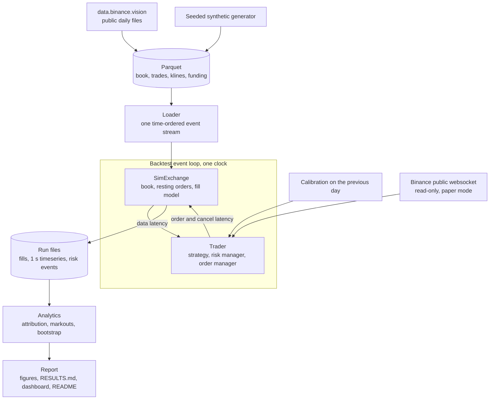

<div align="center">

# QuoteLab

**An event-driven market-making simulator on public Binance futures data.**<br>
How do textbook quoting models hold up once fees, latency and queue position are simulated honestly?

[](pyproject.toml)
[](LICENSE)
[](#data)
[](#limitations)

**English** · [فارسی](README.fa.md)


<sub>One backtest replayed: the busiest minute of a BTCUSDT test day. Top: the market's best bid and ask with our fills. Middle: our position. Bottom: PnL since the window opened.</sub>

</div>

> [!IMPORTANT]
> QuoteLab is a research simulation. It reads public market data only, needs no API keys or
> account, never places an order, and makes no claim of profitability.

**Contents:** [Problem](#the-problem) · [Key results](#key-results) · [What's inside](#whats-inside) · [Quick start](#quick-start) · [Architecture](#architecture) · [Experiments](#experiments) · [Paper trading](#live-paper-trading) · [Feature map](#feature-map) · [Limitations](#limitations)

## The problem

A market maker quotes a bid and an ask, earns the spread when both sides fill, and loses when
the price moves against the inventory it is left holding. Whether a quoting model "works"
depends less on the model than on how fills are simulated: a backtest that fills every order
the price touches, ignores the queue ahead of you and ignores latency can turn a losing strategy
into a winning one.

QuoteLab replays Binance BTCUSDT and ETHUSDT data through one event loop and measures how much
each layer of realism (fees, latency, an estimated queue position) changes the answer.

## Key results

The baseline is GLFT quoting with queue-aware fills and latency, on public Binance USD-M data.
Every number below is written by `make report` from the files a run produced; none is typed by
hand. All of it is simulation.

<!-- quotelab:results:real:start -->
<sub>196 backtests over 4 test days, 6.0 billion market events replayed.</sub>

| Symbol | Mean daily PnL | Spread | Inventory | Fees | Break-even maker fee |
|---|--:|--:|--:|--:|--:|
| `BTCUSDT` | -$1,146.23 | $62.66 | -$387.33 | -$821.58 | -0.79 bps |
| `ETHUSDT` | -$220.87 | $16.59 | -$80.40 | -$157.05 | -0.81 bps |

- **Fill realism.** Mean daily PnL from `optimistic` fills to queue-aware fills with latency (`queue_latency`): `BTCUSDT` -$907.62 → -$1,146.23; `ETHUSDT` -$176.13 → -$220.87.
- **Fees.** The baseline breaks even only with a maker rebate: `BTCUSDT` -0.79 bps, `ETHUSDT` -0.81 bps.

**E1 · Realism ladder.** The baseline's daily PnL as the fill model gets more realistic, rung by rung, beside the same PnL before maker fees.


**E2 · Strategy comparison.** Each quoting model's daily PnL split into spread, inventory, fees, hedging and funding; the diamond is the total.


**E7 · Fee tiers.** The baseline's daily PnL at each maker fee; the break-even fee is where it crosses zero.


<details>
<summary>The E1 realism ladder as a table</summary>

**E1 realism ladder (USD per day)**

| Rung | Symbol | Mean daily PnL [95% CI] | Change vs previous rung |
|---|---|---|---|
| optimistic | BTCUSDT | -907.62 [-1,007.89, -761.22] | n/a |
| trade_through | BTCUSDT | -694.11 [-779.29, -580.08] | 213.51 |
| queue | BTCUSDT | -838.43 [-936.37, -704.16] | -144.32 |
| queue_latency | BTCUSDT | -1,146.23 [-1,268.42, -1,003.59] | -307.80 |
| queue_latency_stress | BTCUSDT | -1,113.77 [-1,240.42, -975.05] | 32.46 |
| optimistic | ETHUSDT | -176.13 [-193.26, -159.00] | n/a |
| trade_through | ETHUSDT | -135.80 [-149.32, -122.28] | 40.33 |
| queue | ETHUSDT | -159.13 [-176.23, -142.03] | -23.33 |
| queue_latency | ETHUSDT | -220.87 [-235.94, -208.18] | -61.74 |
| queue_latency_stress | ETHUSDT | -217.80 [-232.46, -204.62] | 3.07 |

</details>

Every table and figure: [reports/real/RESULTS.md](reports/real/RESULTS.md). The same report as one HTML page to open locally: `reports/real/dashboard.html`.
<!-- quotelab:results:real:end -->

<details>
<summary><b>The same experiments on synthetic data</b>, reproducible without any download</summary>

<!-- quotelab:results:synthetic:start -->
<sub>98 backtests over 4 test days, 4.0 million market events replayed.</sub>

| Symbol | Mean daily PnL | Spread | Inventory | Fees | Break-even maker fee |
|---|--:|--:|--:|--:|--:|
| `SYNTHUSDT` | -$80.70 | $0.69 | -$1.14 | -$80.26 | -0.01 bps |

- **Fill realism.** Mean daily PnL from `optimistic` fills to queue-aware fills with latency (`queue_latency`): `SYNTHUSDT` -$289.49 → -$80.70.
- **Fees.** The baseline breaks even only with a maker rebate: `SYNTHUSDT` -0.01 bps.

**E1 · Realism ladder.** The baseline's daily PnL as the fill model gets more realistic, rung by rung, beside the same PnL before maker fees.


**E2 · Strategy comparison.** Each quoting model's daily PnL split into spread, inventory, fees, hedging and funding; the diamond is the total.


**E7 · Fee tiers.** The baseline's daily PnL at each maker fee; the break-even fee is where it crosses zero.


<details>
<summary>The E1 realism ladder as a table</summary>

**E1 realism ladder (USD per day)**

| Rung | Symbol | Mean daily PnL [95% CI] | Change vs previous rung |
|---|---|---|---|
| optimistic | SYNTHUSDT | -289.49 [-294.52, -282.39] | n/a |
| trade_through | SYNTHUSDT | -34.52 [-36.52, -32.52] | 254.97 |
| queue | SYNTHUSDT | -78.62 [-80.33, -76.92] | -44.10 |
| queue_latency | SYNTHUSDT | -80.70 [-83.49, -77.91] | -2.08 |
| queue_latency_stress | SYNTHUSDT | -74.26 [-75.30, -73.27] | 6.44 |

</details>

Every table and figure: [reports/synthetic/RESULTS.md](reports/synthetic/RESULTS.md). The same report as one HTML page to open locally: `reports/synthetic/dashboard.html`.
<!-- quotelab:results:synthetic:end -->

</details>

`make report` also writes each report as a single HTML page:


## What's inside

<table>
<tr>
<td width="50%" valign="top">

**Event-driven engine**<br>
One clock replays book and trade events in time order. The trader sees data after a data
latency; its orders and cancels reach the simulated exchange after their own latencies.

</td>
<td width="50%" valign="top">

**Three fill models**<br>
Optimistic, trade-through and queue-aware with an estimated queue position, so the effect of
fill realism is measured rather than assumed.

</td>
</tr>
<tr>
<td valign="top">

**Quoting models**<br>
Fixed spread, inventory skew, Avellaneda-Stoikov and GLFT, around a microprice fair value with
an order-flow-imbalance term.

</td>
<td valign="top">

**Walk-forward calibration**<br>
Volatility and the fill intensity `A·exp(−k·δ)` are fitted on the previous day only, so no test
day sees its own data.

</td>
</tr>
<tr>
<td valign="top">

**Risk layer**<br>
A hard inventory bound, latched kill switches, temporary circuit breakers, a staged size ramp
and an optional taker hedge.

</td>
<td valign="top">

**Analytics**<br>
PnL attribution reconciled to final equity on every run, markouts at 1 to 60 seconds in DuckDB,
and day-level bootstrap intervals.

</td>
</tr>
<tr>
<td valign="top">

**Live paper mode**<br>
The same engine on Binance's public, read-only websocket, then a replay of the recorded session
to measure the live-versus-backtest gap.

</td>
<td valign="top">

**Generated reports**<br>
Figures, `RESULTS.md`, an HTML dashboard and the numbers in this README, all written from run
files.

</td>
</tr>
</table>

## Quick start

Needs [uv](https://docs.astral.sh/uv/) and Python 3.11 or later. Three commands rebuild every
synthetic result and figure from a clean clone:

```bash
make install
make backtest
make report
```

| Command | What it does |
|---|---|
| `make install` | Create the environment from the lockfile |
| `make backtest` | Write the seeded synthetic dataset and run experiments E1 to E7 |
| `make report` | Write `reports/synthetic/` and refresh the synthetic block of this README |
| `make real` | The same on Binance data: download, verify, convert, backtest and report |
| `make paper` | A live paper session on the public feed, then its replay |
| `make test` | The test suite |

## Architecture



<details>
<summary>The same flow with module names</summary>

```text
 data.binance.vision (public files)             synthetic generator (seeded)
        │ download, SHA-256 check, convert                │
        ▼                                                 ▼
  data/processed/*.parquet   (book, trades, klines, funding; real units, ts in ns)
        │
        ▼
  loader ── one time-ordered event stream (ts, kind, row)
        │                        calibration on the previous day: σ, A, k, OFI β, γ
        ▼                                         │
 ┌─────────────────────── Backtest event loop (one clock) ───────────────────────┐
 │                                                                                │
 │  market event ──▶ SimExchange: book, resting orders, fill model                │
 │       │           (optimistic | trade-through | queue-aware)                   │
 │       │ data latency                         ▲ order / cancel latency          │
 │       ▼                                      │                                 │
 │  Trader: Strategy (fixed | skew | A-S | GLFT) ─▶ RiskManager ─▶ OrderManager   │
 │          Portfolio: cash, position, fees, funding                              │
 │                                                                                │
 └───────────────────────────────────┬────────────────────────────────────────────┘
                                     │ Recorder: fills, 1 s timeseries, risk events
                                     ▼
  experiments E1–E7 (process pool) ──▶ runs/<dataset>/*.parquet
                                     ▼
  analytics: attribution + reconciliation, markouts (DuckDB SQL), bootstrap intervals
                                     ▼
  report: figures, RESULTS.md, dashboard.html, the results blocks in this README

  live/paper_runner.py: public websocket (asyncio, read-only, reconnect, heartbeat)
        ──▶ the same Backtest loop, fed message by message ──▶ runs/paper/<session>/
        ──▶ paper-compare: replay the recorded feed, compare fills, PnL and risk events
```

</details>

Nothing can read an event before its timestamp: the trader only sees what has arrived after its
data latency, and the exchange only sees orders after their own latency.
[docs/DESIGN.md](docs/DESIGN.md) explains how look-ahead is prevented and how fills are modelled.

## Experiments

| | Question | What varies |
|---|---|---|
| **E1** | How much does fill realism change the PnL? | Fill model and latency, five rungs |
| **E2** | Which quoting model does best, and where does its PnL come from? | Strategy |
| **E3** | How sensitive is the baseline to its settings? | Skew, order size, inventory bound |
| **E4** | What does latency cost? | Order latency |
| **E5** | Which strategies suffer when volatility rises? | Low- and high-volatility hours |
| **E6** | Do the risk controls help in the most violent hour? | Risk controls off and on |
| **E7** | At what maker fee would the baseline break even? | Maker fee |

Each experiment's tables, figures and a plain-language reading are in
[reports/real/RESULTS.md](reports/real/RESULTS.md).

## Live paper trading

`make paper` runs the same strategy and engine on Binance's public, read-only websocket (15
minutes of warm-up, then 60 minutes), simulating fills locally. The recorded feed is then
replayed through the backtest and the two are compared fill by fill. The latest session:

<!-- quotelab:results:paper:start -->
`BTCUSDT`, live window 2026-10-12 09:38 to 2026-10-12 10:38 UTC.

| | Paper (live feed) | Replay (backtest) |
|---|--:|--:|
| PnL | -$21.31 | -$20.92 |
| Quote fills | 360 | 352 |

- **Fills.** The first 14 fills match exactly; fill 15 differs: paper buy 0.003 at 83,397.40, 60.510 s into the window, replay buy 0.003 at 83,403.80, 60.009 s into the window.
- **Feed.** 1,064,730 messages, 0 reconnects, 9.58% clamped to the engine clock, median delay -284.6 ms against the 5 ms the engine assumes.


Full comparison: [reports/paper/20261012T0923Z/COMPARISON.md](reports/paper/20261012T0923Z/COMPARISON.md).
<!-- quotelab:results:paper:end -->

## Feature map

<details>
<summary>How each part of QuoteLab maps to a market-making responsibility</summary>

| Responsibility | Where it lives |
|---|---|
| Fair value | Microprice plus an order-flow-imbalance term with a slope fitted on the previous day (`strategies/signals.py`, `strategies/quoting.py`) |
| Spreads and skew | Fixed and inventory-skew baselines, Avellaneda-Stoikov, and GLFT with γ solved from a skew target (`strategies/`); E2 compares them, E3 sweeps the skew |
| Order sizing and inventory limits | Order size in lots, a hard inventory bound applied before sending, a staged size ramp (`strategies/quoting.py`, `risk/manager.py`); E3 sweeps size and the bound |
| Markouts and adverse selection | Markouts and adverse-selection markouts at 1, 5, 30 and 60 s in DuckDB SQL (`analytics/sql/markouts.sql`) |
| PnL attribution, fees and fill rates | Spread, inventory, fees, hedging and funding, reconciled to final equity on every run (`analytics/attribution.py`); fill rate per order sent; E7 fee tiers and break-even maker fee |
| Hedging and inventory risk | Optional taker hedge above a threshold and flatten-on-kill (`risk/manager.py`); inventory PnL attributed separately |
| Realistic backtests: fees, latency, queue position | Separate data, order and cancel latencies in one event loop (`engine/backtest.py`); queue-aware fills (`fills/queue_aware.py`); E1 realism ladder, E4 latency sweep |
| Staged rollouts, kill switches, circuit breakers | Size ramp, latched kill switches and temporary breakers (`risk/manager.py`); E6 event study with risk controls off and on |
| Live-versus-backtest gaps | Read-only paper trading on the public websocket and a replay of the same session (`live/`) that reports where fills and PnL differ |
| Production Python | asyncio websocket client with reconnect, backoff and a heartbeat watchdog; typed, small modules; pytest suite; ruff; uv lockfile; data and run outputs kept out of version control |

</details>

## Documents

| Document | What it covers |
|---|---|
| [docs/MODEL.md](docs/MODEL.md) | Every formula, with a notation table and a derivation sketch |
| [docs/DESIGN.md](docs/DESIGN.md) | Why event-driven, how look-ahead is prevented, how fills are modelled, known approximations |
| [docs/INTERVIEW_NOTES.md](docs/INTERVIEW_NOTES.md) | Likely interview questions with answers drawn from this code, and a glossary |
| [notebooks/quotelab.ipynb](notebooks/quotelab.ipynb) | Rebuilds the key tables and figures of one dataset from its run files |

## Data

```bash
make data-dry
make data
```

`make data-dry` lists every file with its remote size and the total before anything is fetched.

<details>
<summary>What <code>make data</code> does</summary>

It downloads public daily files (best bid/offer, trades, 1-minute klines, funding) from
`data.binance.vision` into `data/raw/`, verifies each file against Binance's published SHA-256
checksum, records it in `data/raw/checksums.json` so reruns skip completed files, and converts
the CSVs to Parquet in `data/processed/` with a streaming reader. Downloads above
`data.max_download_gb` in `config/default.yaml` are refused unless `--allow-large` is passed.
Both data directories are git-ignored, as are `runs/` and the paper sessions.

The dates and symbols are set in `config/default.yaml`. The first date is used only for
calibration; each later date is a test day calibrated on the day before it.

</details>

## Limitations

- **No full L2 depth.** The data is top of book and trade prints, so the queue ahead of an
  order is estimated from the displayed touch size, not observed.
- **No market impact.** Our orders and fills do not move the simulated book.
- **Single venue.** No cross-venue fair value, hedging or latency races.
- **Simulated, not live.** Even paper mode simulates fills locally; no order ever reaches an
  exchange.
- **Short sample.** A few days per symbol; the bootstrap intervals are wide and only a rough
  range, not a significance test.
- **Limited calibration data.** Volatility, intensity and the OFI slope come from one previous
  day; risk thresholds are round numbers chosen by hand.
- **Unverified venue constants.** The maker and taker fees (2 and 5 bps) and minimum notionals in
  `config/default.yaml` were not checked against Binance's current schedule; E7 shows how
  results move with the maker fee.
- **Not investment advice.** Nothing here is a recommendation to trade.

## What I would do next with real L2 data

- Track the queue from order-level or full-depth data and validate the queue-aware fill rates
  against it.
- Quote at more than one level and measure how depth changes fill rates and adverse selection.
- Calibrate the fill intensity from the depletion of resting depth, not taker excursions.
- Add a market-impact model so large orders and hedges move the simulated book.
- Use longer samples across calm and stressed months, with out-of-sample risk thresholds.
- Run multi-venue: a cross-venue fair value and hedging on a second exchange.

## License

[MIT](LICENSE).
