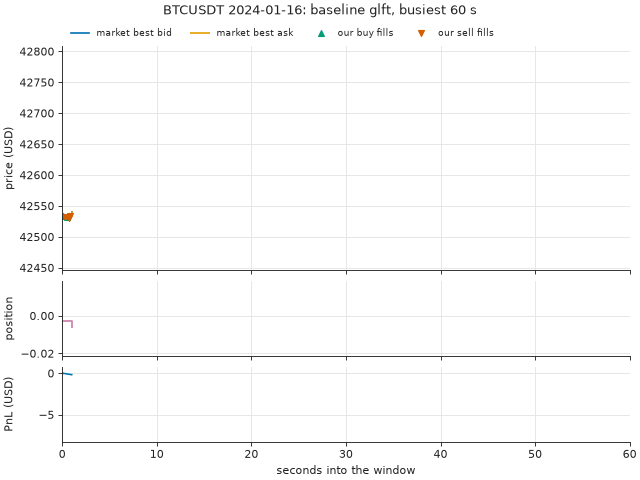
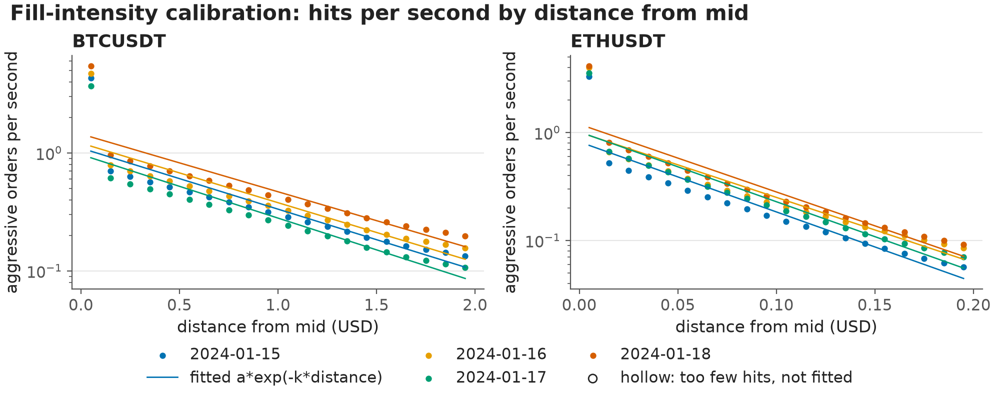
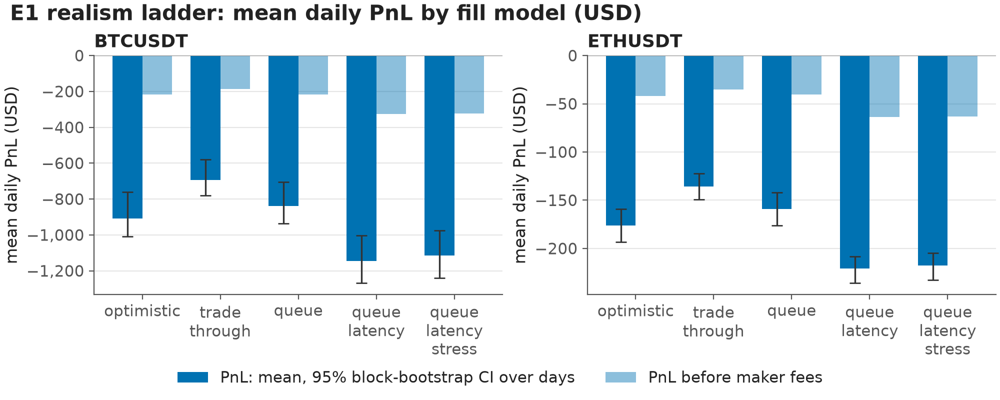
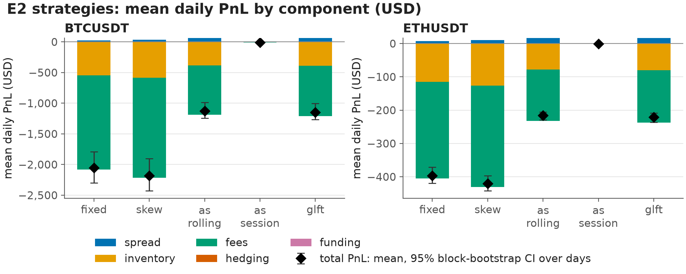
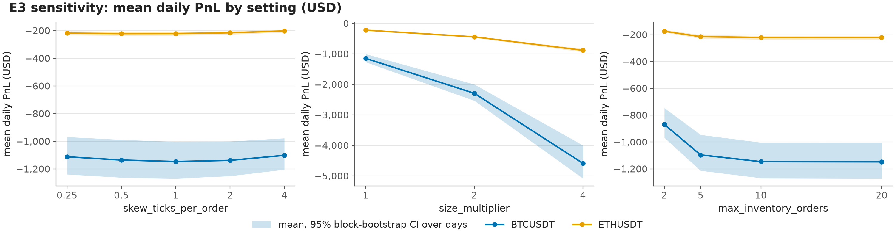
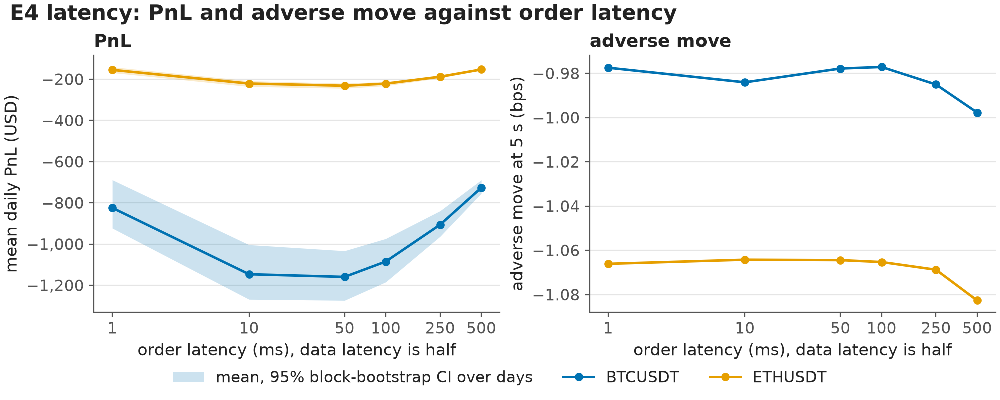
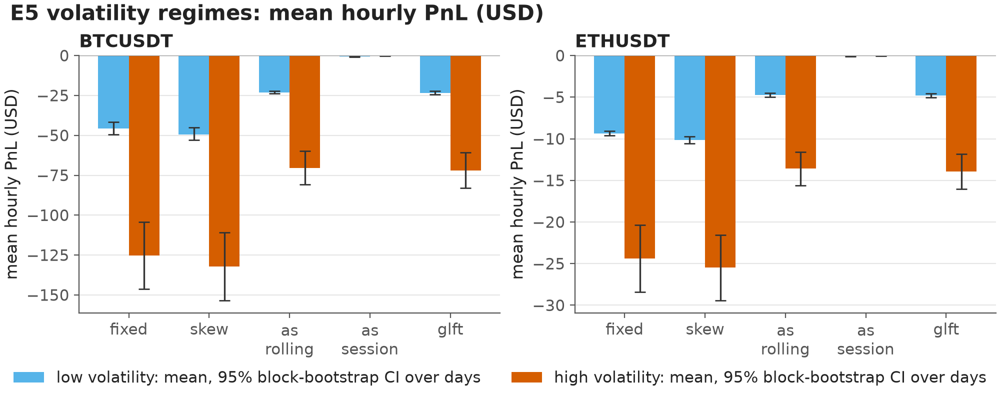
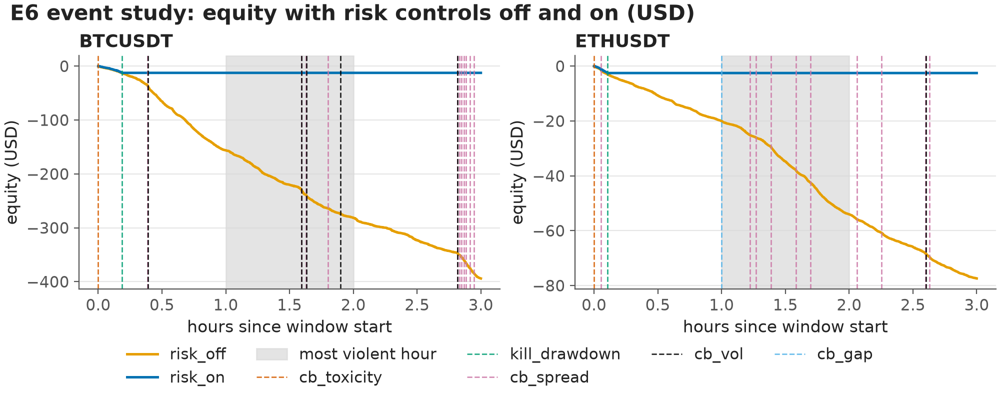
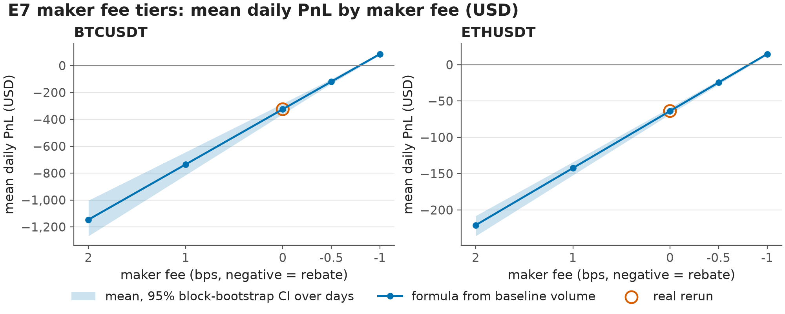
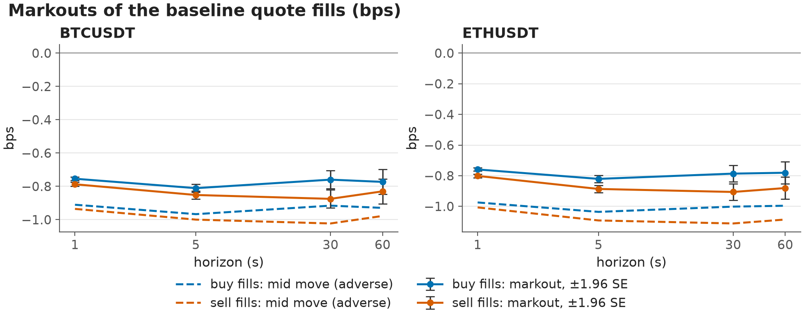

# QuoteLab results: Binance data

Public Binance USD-M perpetual futures data for `BTCUSDT`, `ETHUSDT`: top of book (`bookTicker`) and trade prints, no order-book depth. 4 test days from 2024-01-16 to 2024-01-19; each test day runs with parameters calibrated on the day before it and on nothing later (walk-forward).

284 experiment jobs ran as 196 distinct backtests: jobs whose configuration is identical (the E1 `queue_latency` rung, the E2 `glft` strategy, the E4 baseline latency and the E7 baseline) share one run.

Values in brackets are 95% block-bootstrap intervals of the mean over test days, resampling whole days. With 4 test days per cell they are crude: read them as a rough range, not as a significance test. With one day there is no interval.

Everything here is a simulation with an estimated queue position, no market impact and a single venue. Nothing in it is evidence that a strategy would make money live, and none of it is investment advice.

## Contents

- [Replay of the baseline run](#replay)
- [Calibration](#calibration)
- [E1 · Realism ladder](#e1)
- [E2 · Strategy comparison](#e2)
- [E3 · Parameter sensitivity](#e3)
- [E4 · Latency](#e4)
- [E5 · Volatility regimes](#e5)
- [E6 · Event study](#e6)
- [E7 · Fee tiers](#e7)
- [Markouts](#markouts)
- [Run cost](#cost)

## Replay of the baseline run

`BTCUSDT` on 2024-01-16, baseline `glft` (the `queue_latency` rung of E1): the 60 seconds of the day with the most quote fills, drawn from the run's own files. Top: the market's best bid and ask with our buy and sell fills; the bid and ask are the run's once-a-second samples, so a fill between two samples can sit outside them. Middle: our position. Bottom: the PnL since the window opened.

## Calibration

`sigma` is the root mean square of one-second mid changes in USD per √s. `A` and `k` come from an ordinary least-squares fit of ln λ(δ) = ln A − kδ, where λ(δ) is the number of aggressive orders per second whose deepest print reached δ USD past the mid just before them, both sides pooled; levels with fewer than 30 hits are left out of the fit. `ofi_beta` is the slope of the next second's mid change on the normalised order-flow imbalance of the trailing window.

`BTCUSDT`, 4 calibration days: sigma 2.9288 to 3.6472 USD/√s (1-minute klines: 3.1477 to 3.7044). k averaged 0.118 per tick of 0.1 USD, so the fitted hit rate falls by a factor of e every 8.5 ticks; R² 0.782 to 0.808 over 20 distance levels. The first level, the touch, carried 38.2 to 40.7% of all hits, and its measured rate was 4.0 to 4.2 times the fitted curve there. The touch is under-fitted on every day: most takers stop at the best price, a point mass that a single exponential cannot carry, so `A` understates fills at the touch and overstates them a few ticks away. The OFI slope averaged 1.2527 USD per unit of imbalance with R² at most 1.35%: that is the most of the next second's mid variance the imbalance explained on any day.

`ETHUSDT`, 4 calibration days: sigma 0.1825 to 0.2213 USD/√s (1-minute klines: 0.2011 to 0.2276). k averaged 0.145 per tick of 0.01 USD, so the fitted hit rate falls by a factor of e every 6.9 ticks; R² 0.829 to 0.869 over 20 distance levels. The first level, the touch, carried 41.5 to 46.7% of all hits, and its measured rate was 3.7 to 4.3 times the fitted curve there. The touch is under-fitted on every day: most takers stop at the best price, a point mass that a single exponential cannot carry, so `A` understates fills at the touch and overstates them a few ticks away. The OFI slope averaged 0.0700 USD per unit of imbalance with R² at most 1.56%: that is the most of the next second's mid variance the imbalance explained on any day.

**Calibration per day (each is used to run the following day)**

| Symbol | Calibrated on | sigma (USD/√s) | sigma, klines | A (1/s) | A s.e. | k (1/USD) | k s.e. | R² | Levels | Touch share of hits | OFI beta (USD) | OFI R² |
|---|---|---|---|---|---|---|---|---|---|---|---|---|
| BTCUSDT | 2024-01-15 | 3.1881 | 3.3844 | 1.099 | 0.184 | 1.192 | 0.145 | 0.790 | 20 | 40.5% | 1.2820 | 0.0129 |
| BTCUSDT | 2024-01-16 | 3.5352 | 3.7044 | 1.211 | 0.201 | 1.162 | 0.144 | 0.784 | 20 | 39.7% | 1.3255 | 0.0110 |
| BTCUSDT | 2024-01-17 | 2.9288 | 3.1477 | 0.969 | 0.159 | 1.240 | 0.142 | 0.808 | 20 | 40.7% | 1.2459 | 0.0135 |
| BTCUSDT | 2024-01-18 | 3.6472 | 3.6774 | 1.448 | 0.234 | 1.127 | 0.140 | 0.782 | 20 | 38.2% | 1.1572 | 0.0068 |
| ETHUSDT | 2024-01-15 | 0.1825 | 0.2011 | 0.820 | 0.142 | 14.944 | 1.498 | 0.847 | 20 | 46.7% | 0.0693 | 0.0156 |
| ETHUSDT | 2024-01-16 | 0.2138 | 0.2276 | 1.007 | 0.173 | 13.896 | 1.485 | 0.829 | 20 | 44.5% | 0.0774 | 0.0131 |
| ETHUSDT | 2024-01-17 | 0.2028 | 0.2171 | 1.016 | 0.160 | 14.904 | 1.365 | 0.869 | 20 | 42.9% | 0.0683 | 0.0126 |
| ETHUSDT | 2024-01-18 | 0.2213 | 0.2222 | 1.196 | 0.186 | 14.452 | 1.346 | 0.865 | 20 | 41.5% | 0.0653 | 0.0093 |

## E1 · Realism ladder

The same `glft` strategy, calibration and days under five fill and latency assumptions. `optimistic`: any touch of our price fills the whole order. `trade_through`: only a trade strictly through our price fills it. `queue`: the lots queued ahead of us, estimated from top-of-book sizes, must trade away first. These three have no latency. `queue_latency` adds 5 ms market-data and 10 ms order latency and is the baseline of every other experiment. `queue_latency_stress` is the adverse-selection stress: `alpha` = 0, so no unexplained drop in size at our price counts as a cancellation ahead of us, and `participation` = 0.5, so only that share of the volume traded at our price reaches our queue. The rungs are not nested bounds on fills: with latency a quote keeps its old price until the trader's update or cancel arrives, and it can fill in that window, so a latency rung can fill more often than `optimistic`.

`BTCUSDT`: mean daily PnL -$907.62 under `optimistic` and -$1,113.77 under `queue_latency_stress`, a difference of -$206.15 a day. Change at each step: `trade_through` $213.51, `queue` -$144.32, `queue_latency` -$307.80, `queue_latency_stress` $32.46. The largest single drop came at `queue_latency` (-$307.80). Before maker fees the first and last rungs made -$215.82 and -$323.43; maker fees contributed -$821.58 a day to the baseline on $4,107,878.35 of maker volume. Quote fills went from 27,382 to 31,430 a day. The most quote fills came under `queue_latency` (32,672 a day), not under `optimistic`.

`ETHUSDT`: mean daily PnL -$176.13 under `optimistic` and -$217.80 under `queue_latency_stress`, a difference of -$41.67 a day. Change at each step: `trade_through` $40.33, `queue` -$23.33, `queue_latency` -$61.74, `queue_latency_stress` $3.07. The largest single drop came at `queue_latency` (-$61.74). Before maker fees the first and last rungs made -$42.11 and -$63.24; maker fees contributed -$157.05 a day to the baseline on $785,238.74 of maker volume. Quote fills went from 26,639 to 30,809 a day. The most quote fills came under `queue_latency` (31,353 a day), not under `optimistic`.

What this can say: how much of the simulated PnL rests on each fill assumption, with everything else held fixed. What it cannot say: which rung is right. With top-of-book data the queue ahead of us is never observed, so `queue` is an estimate and the stress rung is an assumption about it, not a measurement. No rung models the market impact of our own orders, and the ladder only brackets reality if reality lies between the rungs, which this data cannot show.

**E1 realism ladder (USD per day unless stated)**

| Rung | Symbol | Days | Mean daily PnL [95% CI] | Change vs previous rung | PnL before maker fees | Quote fills | Adverse 5 s (bps) |
|---|---|---|---|---|---|---|---|
| optimistic | BTCUSDT | 4 | -907.62 [-1,007.89, -761.22] | n/a | -215.82 | 27,382 | -0.85 |
| trade_through | BTCUSDT | 4 | -694.11 [-779.29, -580.08] | 213.51 | -187.34 | 20,067 | -1.00 |
| queue | BTCUSDT | 4 | -838.43 [-936.37, -704.16] | -144.32 | -218.47 | 24,622 | -0.94 |
| queue_latency | BTCUSDT | 4 | -1,146.23 [-1,268.42, -1,003.59] | -307.80 | -324.65 | 32,672 | -0.98 |
| queue_latency_stress | BTCUSDT | 4 | -1,113.77 [-1,240.42, -975.05] | 32.46 | -323.43 | 31,430 | -1.02 |
| optimistic | ETHUSDT | 4 | -176.13 [-193.26, -159.00] | n/a | -42.11 | 26,639 | -0.97 |
| trade_through | ETHUSDT | 4 | -135.80 [-149.32, -122.28] | 40.33 | -34.95 | 20,044 | -1.09 |
| queue | ETHUSDT | 4 | -159.13 [-176.23, -142.03] | -23.33 | -40.38 | 23,664 | -1.04 |
| queue_latency | ETHUSDT | 4 | -220.87 [-235.94, -208.18] | -61.74 | -63.82 | 31,353 | -1.06 |
| queue_latency_stress | ETHUSDT | 4 | -217.80 [-232.46, -204.62] | 3.07 | -63.24 | 30,809 | -1.08 |

## E2 · Strategy comparison

`fixed` quotes 0.5 tick(s) either side of fair value whatever the inventory; `skew` adds a linear skew of 1 tick(s) per order held; `glft` is the Guéant–Lehalle–Fernandez-Tapia closed form with γ back-solved from 1 tick(s) of skew per order held. `as_rolling` is Avellaneda–Stoikov with a constant horizon chosen so that it quotes like GLFT at the calibrated sigma; `as_session` takes the time left until 00:00 UTC as its horizon. Fair value is the `microprice` plus the OFI signal for all of them. PnL is split into spread (half-spread earned against the mid at each fill), inventory (mark-to-market of the position held), fees, hedging and funding; the five add up to the final equity of every run.

`BTCUSDT`: highest mean daily PnL `as_session` -$8.34, lowest `skew` -$2,182.34. For `glft` the day splits into spread $62.66, inventory -$387.33, fees -$821.58, hedging $0.00 and funding $0.02. `as_session` ranks first with 251 quote fills a day against 32,672 for `glft`; per quote fill it made -0.0332 USD against -0.0351 USD for `glft`. With the session horizon the A–S spread term γΔσ²τ is wide for most of the day, so `as_session` quotes far from the touch and trades least. A quote that would cross the opposite touch is moved back to the touch (post-only clamp); share of quote updates clamped: `as_session` 0.4%, `as_rolling` 8.8%, `glft` 7.9%, `fixed` 78.7%, `skew` 84.5%.

`ETHUSDT`: highest mean daily PnL `as_session` -$0.93, lowest `skew` -$420.13. For `glft` the day splits into spread $16.59, inventory -$80.40, fees -$157.05, hedging $0.00 and funding -$0.00. `as_session` ranks first with 142 quote fills a day against 31,353 for `glft`; per quote fill it made -0.0065 USD against -0.0070 USD for `glft`. With the session horizon the A–S spread term γΔσ²τ is wide for most of the day, so `as_session` quotes far from the touch and trades least. A quote that would cross the opposite touch is moved back to the touch (post-only clamp); share of quote updates clamped: `as_session` 0.2%, `as_rolling` 5.6%, `glft` 4.8%, `fixed` 69.0%, `skew` 80.9%.

**E2 strategies (USD per day)**

| Strategy | Symbol | Mean daily PnL [95% CI] | Spread | Inventory | Fees | Hedging | Funding | Quote fills | Clamped to touch | Adverse 5 s (bps) | Mean \|position\| (base units) |
|---|---|---|---|---|---|---|---|---|---|---|---|
| fixed | BTCUSDT | -2,055.35 [-2,297.55, -1,791.52] | 26.59 | -547.60 | -1,534.31 | 0.00 | -0.02 | 62,458 | 78.7% | -0.73 | 0.0169 |
| skew | BTCUSDT | -2,182.34 [-2,426.25, -1,905.41] | 35.33 | -586.00 | -1,631.66 | 0.00 | -0.01 | 66,409 | 84.5% | -0.73 | 0.0066 |
| as_rolling | BTCUSDT | -1,124.50 [-1,243.28, -987.16] | 62.22 | -381.04 | -805.72 | 0.00 | 0.04 | 32,059 | 8.8% | -0.99 | 0.0094 |
| as_session | BTCUSDT | -8.34 [-9.74, -6.95] | 0.93 | -2.96 | -6.31 | 0.00 | 0.00 | 251 | 0.4% | -0.93 | 0.0000 |
| glft | BTCUSDT | -1,146.23 [-1,268.42, -1,003.59] | 62.66 | -387.33 | -821.58 | 0.00 | 0.02 | 32,672 | 7.9% | -0.98 | 0.0083 |
| fixed | ETHUSDT | -397.01 [-419.02, -370.62] | 7.55 | -115.21 | -289.34 | 0.00 | -0.01 | 59,371 | 69.0% | -0.86 | 0.0533 |
| skew | ETHUSDT | -420.13 [-441.69, -396.50] | 10.05 | -126.01 | -304.17 | 0.00 | -0.00 | 62,504 | 80.9% | -0.85 | 0.0198 |
| as_rolling | ETHUSDT | -216.17 [-228.99, -205.16] | 16.42 | -78.15 | -154.43 | 0.00 | -0.00 | 30,846 | 5.6% | -1.06 | 0.0255 |
| as_session | ETHUSDT | -0.93 [-1.13, -0.72] | 0.12 | -0.35 | -0.70 | 0.00 | 0.00 | 142 | 0.2% | -0.94 | 0.0001 |
| glft | ETHUSDT | -220.87 [-235.94, -208.18] | 16.59 | -80.40 | -157.05 | 0.00 | -0.00 | 31,353 | 4.8% | -1.06 | 0.0227 |

## E3 · Parameter sensitivity

One GLFT parameter at a time, everything else at the baseline. Risk aversion is set through the skew it implies per order held, 0.25, 0.5, 1, 2, 4 ticks (baseline 1), and γ is back-solved from it. Order size is the baseline order times 1, 2, 4. The inventory limit is 2, 5, 10, 20 orders (baseline 10).

`BTCUSDT`: across skews, mean daily PnL ranged from -$1,146.23 at 1 ticks to -$1,101.57 at 4. Order size ×1 to ×4 moved it from -$1,146.23 to -$4,587.56. γ went from 0.3091 to 0.0773: it is back-solved for the same skew per order, so a larger order implies a different γ, and this row mixes a size change with a risk-aversion change. Inventory limits from 2 to 20 orders gave mean daily PnL from -$868.88 to -$1,147.26.

`ETHUSDT`: across skews, mean daily PnL ranged from -$221.59 at 0.5 ticks to -$202.34 at 4. Order size ×1 to ×4 moved it from -$220.87 to -$881.43. γ went from 2.5639 to 0.6410: it is back-solved for the same skew per order, so a larger order implies a different γ, and this row mixes a size change with a risk-aversion change. Inventory limits from 2 to 20 orders gave mean daily PnL from -$174.07 to -$220.57.

**E3 sensitivity (USD per day)**

| Parameter | Value | Symbol | Mean daily PnL [95% CI] | Quote fills | Mean \|position\| (base units) | Max drawdown | γ |
|---|---|---|---|---|---|---|---|
| max_inventory_orders | 2.00 | BTCUSDT | -868.88 [-967.26, -746.59] | 23,919 | 0.0034 | 868.88 | 0.3091 |
| max_inventory_orders | 5.00 | BTCUSDT | -1,095.66 [-1,213.14, -945.74] | 30,876 | 0.0066 | 1,095.66 | 0.3091 |
| max_inventory_orders | 10.00 | BTCUSDT | -1,146.23 [-1,268.42, -1,003.59] | 32,672 | 0.0083 | 1,146.30 | 0.3091 |
| max_inventory_orders | 20.00 | BTCUSDT | -1,147.26 [-1,271.05, -1,002.90] | 32,738 | 0.0084 | 1,147.33 | 0.3091 |
| max_inventory_orders | 2.00 | ETHUSDT | -174.07 [-182.38, -163.20] | 24,130 | 0.0105 | 174.07 | 2.5639 |
| max_inventory_orders | 5.00 | ETHUSDT | -214.82 [-229.35, -201.82] | 30,303 | 0.0198 | 214.82 | 2.5639 |
| max_inventory_orders | 10.00 | ETHUSDT | -220.87 [-235.94, -208.18] | 31,353 | 0.0227 | 220.87 | 2.5639 |
| max_inventory_orders | 20.00 | ETHUSDT | -220.57 [-235.08, -208.12] | 31,342 | 0.0228 | 220.57 | 2.5639 |
| size_multiplier | 1.00 | BTCUSDT | -1,146.23 [-1,268.42, -1,003.59] | 32,672 | 0.0083 | 1,146.30 | 0.3091 |
| size_multiplier | 2.00 | BTCUSDT | -2,291.85 [-2,533.00, -1,998.74] | 33,112 | 0.0166 | 2,292.01 | 0.1545 |
| size_multiplier | 4.00 | BTCUSDT | -4,587.56 [-5,082.01, -3,998.14] | 33,824 | 0.0337 | 4,587.90 | 0.0773 |
| size_multiplier | 1.00 | ETHUSDT | -220.87 [-235.94, -208.18] | 31,353 | 0.0227 | 220.87 | 2.5639 |
| size_multiplier | 2.00 | ETHUSDT | -440.79 [-470.55, -414.27] | 31,654 | 0.0449 | 440.78 | 1.2820 |
| size_multiplier | 4.00 | ETHUSDT | -881.43 [-938.66, -831.75] | 31,861 | 0.0907 | 881.43 | 0.6410 |
| skew_ticks_per_order | 0.25 | BTCUSDT | -1,111.96 [-1,239.08, -968.57] | 31,413 | 0.0138 | 1,112.02 | 0.0193 |
| skew_ticks_per_order | 0.50 | BTCUSDT | -1,135.46 [-1,262.24, -988.62] | 32,162 | 0.0115 | 1,135.53 | 0.0773 |
| skew_ticks_per_order | 1.00 | BTCUSDT | -1,146.23 [-1,268.42, -1,003.59] | 32,672 | 0.0083 | 1,146.30 | 0.3091 |
| skew_ticks_per_order | 2.00 | BTCUSDT | -1,137.95 [-1,251.38, -1,000.68] | 32,564 | 0.0057 | 1,137.97 | 1.2349 |
| skew_ticks_per_order | 4.00 | BTCUSDT | -1,101.57 [-1,204.54, -977.71] | 31,699 | 0.0039 | 1,101.57 | 4.9166 |
| skew_ticks_per_order | 0.25 | ETHUSDT | -217.88 [-232.35, -203.96] | 31,202 | 0.0411 | 217.89 | 0.1604 |
| skew_ticks_per_order | 0.50 | ETHUSDT | -221.59 [-237.05, -207.37] | 31,546 | 0.0322 | 221.60 | 0.6414 |
| skew_ticks_per_order | 1.00 | ETHUSDT | -220.87 [-235.94, -208.18] | 31,353 | 0.0227 | 220.87 | 2.5639 |
| skew_ticks_per_order | 2.00 | ETHUSDT | -215.49 [-228.28, -204.99] | 30,638 | 0.0154 | 215.49 | 10.2288 |
| skew_ticks_per_order | 4.00 | ETHUSDT | -202.34 [-212.85, -193.72] | 28,975 | 0.0107 | 202.34 | 40.4958 |

## E4 · Latency

Order and cancel latency over 1, 10, 50, 100, 250, 500 ms, with market-data latency half of the order latency. 10 ms is the baseline.

`BTCUSDT`: mean daily PnL -$824.16 at 1 ms and -$726.33 at 500 ms, a gain of $97.83 a day. The mid move 5 s after a fill went from -0.98 to -1.00 bps and quote fills from 23,851 to 20,708 a day. PnL did not fall steadily with latency: the lowest mean was -$1,159.17 at 50 ms.

`ETHUSDT`: mean daily PnL -$154.74 at 1 ms and -$152.64 at 500 ms, a gain of $2.11 a day. The mid move 5 s after a fill went from -1.07 to -1.08 bps and quote fills from 22,594 to 22,090 a day. PnL did not fall steadily with latency: the lowest mean was -$231.55 at 50 ms.

**E4 latency (USD per day)**

| Order latency (ms) | Symbol | Mean daily PnL [95% CI] | Quote fills | Adverse 5 s (bps) | Markout 5 s (bps) |
|---|---|---|---|---|---|
| 1 | BTCUSDT | -824.16 [-923.09, -688.74] | 23,851 | -0.98 | -0.78 |
| 10 | BTCUSDT | -1,146.23 [-1,268.42, -1,003.59] | 32,672 | -0.98 | -0.83 |
| 50 | BTCUSDT | -1,159.17 [-1,273.55, -1,032.99] | 32,938 | -0.98 | -0.84 |
| 100 | BTCUSDT | -1,084.65 [-1,184.50, -973.94] | 30,872 | -0.98 | -0.84 |
| 250 | BTCUSDT | -905.65 [-963.11, -839.05] | 25,813 | -0.99 | -0.85 |
| 500 | BTCUSDT | -726.33 [-754.34, -689.07] | 20,708 | -1.00 | -0.85 |
| 1 | ETHUSDT | -154.74 [-168.85, -140.63] | 22,594 | -1.07 | -0.78 |
| 10 | ETHUSDT | -220.87 [-235.94, -208.18] | 31,353 | -1.06 | -0.85 |
| 50 | ETHUSDT | -231.55 [-244.72, -220.06] | 33,031 | -1.06 | -0.88 |
| 100 | ETHUSDT | -221.37 [-232.36, -212.26] | 31,741 | -1.07 | -0.88 |
| 250 | ETHUSDT | -187.83 [-194.38, -182.76] | 27,055 | -1.07 | -0.89 |
| 500 | ETHUSDT | -152.64 [-156.68, -149.65] | 22,090 | -1.08 | -0.90 |

## E5 · Volatility regimes

Each test-day hour is labelled `high` when the sum of its squared one-second mid changes is above its symbol's median over all test hours, otherwise `low`. The label uses the hour's own data, so this describes where PnL came from; it is not a regime signal a strategy could have traded on. The strategies are the E2 runs.

`BTCUSDT` (48 high-volatility hours), mean PnL per hour: `fixed` -$45.82 in low and -$125.14 in high hours; `skew` -$49.31 in low and -$132.15 in high hours; `as_rolling` -$23.20 in low and -$70.31 in high hours; `as_session` -$0.54 in low and -$0.13 in high hours; `glft` -$23.45 in low and -$71.86 in high hours. The largest fall from calm to volatile hours was `skew`, -$82.84 an hour.

`ETHUSDT` (48 high-volatility hours), mean PnL per hour: `fixed` -$9.34 in low and -$24.37 in high hours; `skew` -$10.15 in low and -$25.49 in high hours; `as_rolling` -$4.74 in low and -$13.59 in high hours; `as_session` -$0.05 in low and -$0.02 in high hours; `glft` -$4.80 in low and -$13.92 in high hours. The largest fall from calm to volatile hours was `skew`, -$15.34 an hour.

**E5 volatility regimes (USD per hour)**

| Strategy | Symbol | Regime | Days | Hours | Mean hourly PnL [95% CI] |
|---|---|---|---|---|---|
| fixed | BTCUSDT | high | 4 | 48 | -125.14 [-146.12, -104.17] |
| skew | BTCUSDT | high | 4 | 48 | -132.15 [-153.50, -110.79] |
| as_rolling | BTCUSDT | high | 4 | 48 | -70.31 [-80.93, -59.69] |
| as_session | BTCUSDT | high | 4 | 48 | -0.13 [-0.35, -0.01] |
| glft | BTCUSDT | high | 4 | 48 | -71.86 [-82.99, -60.74] |
| fixed | BTCUSDT | low | 4 | 48 | -45.82 [-49.38, -41.78] |
| skew | BTCUSDT | low | 4 | 48 | -49.31 [-53.04, -44.95] |
| as_rolling | BTCUSDT | low | 4 | 48 | -23.20 [-23.92, -22.17] |
| as_session | BTCUSDT | low | 4 | 48 | -0.54 [-0.77, -0.29] |
| glft | BTCUSDT | low | 4 | 48 | -23.45 [-24.33, -22.15] |
| fixed | ETHUSDT | high | 4 | 48 | -24.37 [-28.40, -20.35] |
| skew | ETHUSDT | high | 4 | 48 | -25.49 [-29.44, -21.55] |
| as_rolling | ETHUSDT | high | 4 | 48 | -13.59 [-15.59, -11.59] |
| as_session | ETHUSDT | high | 4 | 48 | -0.02 [-0.06, 0.00] |
| glft | ETHUSDT | high | 4 | 48 | -13.92 [-16.03, -11.82] |
| fixed | ETHUSDT | low | 4 | 48 | -9.34 [-9.62, -9.06] |
| skew | ETHUSDT | low | 4 | 48 | -10.15 [-10.57, -9.74] |
| as_rolling | ETHUSDT | low | 4 | 48 | -4.74 [-4.98, -4.50] |
| as_session | ETHUSDT | low | 4 | 48 | -0.05 [-0.08, -0.02] |
| glft | ETHUSDT | low | 4 | 48 | -4.80 [-5.04, -4.55] |

## E6 · Event study

Each symbol's most violent hour over all test days (largest sum of squared one-second mid changes) is replayed with 1 hour(s) either side, once with every risk control off and once with all of them on. Kill switches: position beyond 15 orders, drawdown, and no book update for 5 s. Circuit breakers, each pausing quotes for 30 s: 10 s volatility above 4 times the 600 s volatility, spread above 5 bps, |OFI| at least 0.8, and a gap of more than 2 s in market data. Size ramp: 1, 2, 4 times the order size, one step up per 4 hours without a breaker trip. A kill stops quoting for the rest of the run and flattens the position with a taker order.

The drawdown kill fires when equity falls more than `max_drawdown_bps` (100 bps) of the largest allowed position's notional below its peak: 100 / 10,000 × 10 orders × order size × the first mid of the run. That gave $12.27 for `BTCUSDT` and $2.48 for `ETHUSDT`. The 100 bps is a round number chosen for this project, not calibrated, and the risk-on result depends on it directly.

`BTCUSDT` on 2024-01-19: PnL -$394.07 with controls off (max drawdown $393.96) and -$12.40 with controls on (max drawdown $12.40), a gain of $381.68 for the controls. Market data in the window ran from 2024-01-19 16:00 to 2024-01-19 18:59 UTC. `kill_drawdown` fired 11 minutes after the first replayed update (drawdown 12.27 > 12.27 USD). Risk events with controls on: cb_spread 11, cb_toxicity 1, cb_vol 5, kill_drawdown 1.

`ETHUSDT` on 2024-01-19: PnL -$77.42 with controls off (max drawdown $77.39) and -$2.50 with controls on (max drawdown $2.50), a gain of $74.91 for the controls. Market data in the window ran from 2024-01-19 15:00 to 2024-01-19 17:59 UTC. `kill_drawdown` fired 6 minutes after the first replayed update (drawdown 2.48 > 2.48 USD). Risk events with controls on: cb_gap 1, cb_spread 10, cb_toxicity 1, cb_vol 1, kill_drawdown 1.

`kill_inventory` is set at 15 orders, above the inventory limit of 10 orders, and that limit already stops quoting any side that would take the position past it. The switch is therefore a backstop against a fault in the limit; it fired 0 time(s) here.

**E6 windows**

| Symbol | Test day | Window start (UTC) | Window end (UTC) | Most violent hour (UTC) | Realised variance (USD²) |
|---|---|---|---|---|---|
| BTCUSDT | 2024-01-19 | 2024-01-19 16:00 | 2024-01-19 19:00 | 2024-01-19 17:00 | 197,001.52 |
| ETHUSDT | 2024-01-19 | 2024-01-19 15:00 | 2024-01-19 18:00 | 2024-01-19 16:00 | 676.50 |

**E6 risk controls off and on (USD over the window)**

| Symbol | Controls | PnL | Max drawdown | Quote fills | Mean \|position\| (base units) | Risk events | Kill | Drawdown limit | Events by kind |
|---|---|---|---|---|---|---|---|---|---|
| BTCUSDT | risk_off | -394.07 | 393.96 | 11,445 | 0.0061 | 0 | none | n/a | none |
| BTCUSDT | risk_on | -12.40 | 12.40 | 414 | 0.0004 | 18 | kill_drawdown | 12.27 | cb_spread 11, cb_toxicity 1, cb_vol 5, kill_drawdown 1 |
| ETHUSDT | risk_off | -77.42 | 77.39 | 11,169 | 0.0168 | 0 | none | n/a | none |
| ETHUSDT | risk_on | -2.50 | 2.50 | 323 | 0.0008 | 14 | kill_drawdown | 2.48 | cb_gap 1, cb_spread 10, cb_toxicity 1, cb_vol 1, kill_drawdown 1 |

## E7 · Fee tiers

PnL at maker fee m is computed from each baseline run as PnL(m) = PnL(base) + (base − m) / 10,000 × maker volume. It is exact when the fills do not depend on the fee, which holds here: no strategy reads the fee and the baseline has no risk layer. Real reruns at 0 bps test that claim. The baseline fees, maker 2 bps and taker 5 bps, are config values that were not checked against Binance's current fee schedule.

`BTCUSDT`: over 4 test days the baseline would break even at a maker fee of -0.790 bps, a rebate of 0.790 bps. At -1 bps, the lowest fee in the grid, its mean daily PnL would be $86.14.

`ETHUSDT`: over 4 test days the baseline would break even at a maker fee of -0.813 bps, a rebate of 0.813 bps. At -1 bps, the lowest fee in the grid, its mean daily PnL would be $14.70.

8 rerun(s): the largest absolute difference between a rerun's PnL and the formula was 1.2e-11 USD, and 8 of 8 had exactly the baseline's number of quote fills.

**E7 fee tiers (USD per day)**

| Symbol | Maker fee (bps) | Days | Mean daily PnL [95% CI] |
|---|---|---|---|
| BTCUSDT | 2.00 | 4 | -1,146.23 [-1,268.42, -1,003.59] |
| BTCUSDT | 1.00 | 4 | -735.44 [-815.19, -643.82] |
| BTCUSDT | 0.00 | 4 | -324.65 [-361.96, -283.13] |
| BTCUSDT | -0.50 | 4 | -119.26 [-135.35, -101.62] |
| BTCUSDT | -1.00 | 4 | 86.14 [77.16, 95.45] |
| ETHUSDT | 2.00 | 4 | -220.87 [-235.94, -208.18] |
| ETHUSDT | 1.00 | 4 | -142.34 [-152.16, -134.08] |
| ETHUSDT | 0.00 | 4 | -63.82 [-68.39, -59.28] |
| ETHUSDT | -0.50 | 4 | -24.56 [-27.38, -21.73] |
| ETHUSDT | -1.00 | 4 | 14.70 [12.95, 16.37] |

**E7 break-even maker fee over all test days**

| Symbol | Total PnL | Total maker volume | Break-even maker fee (bps) |
|---|---|---|---|
| BTCUSDT | -4,584.91 | 16,431,513 | -0.790 |
| ETHUSDT | -883.47 | 3,140,955 | -0.813 |

**E7 reruns against the formula (USD per day)**

| Symbol | Test day | Maker fee (bps) | Rerun PnL | Formula PnL | \|Difference\| | Same fills |
|---|---|---|---|---|---|---|
| BTCUSDT | 2024-01-16 | 0.00 | -317.22 | -317.22 | 5.1e-12 | True |
| BTCUSDT | 2024-01-17 | 0.00 | -257.47 | -257.47 | 5.1e-13 | True |
| BTCUSDT | 2024-01-18 | 0.00 | -360.11 | -360.11 | 5.8e-12 | True |
| BTCUSDT | 2024-01-19 | 0.00 | -363.81 | -363.81 | 1.2e-11 | True |
| ETHUSDT | 2024-01-16 | 0.00 | -65.69 | -65.69 | 2.0e-12 | True |
| ETHUSDT | 2024-01-17 | 0.00 | -58.08 | -58.08 | 5.5e-13 | True |
| ETHUSDT | 2024-01-18 | 0.00 | -71.02 | -71.02 | 9.4e-13 | True |
| ETHUSDT | 2024-01-19 | 0.00 | -60.49 | -60.49 | 1.0e-12 | True |

## Markouts

For each fill of the baseline, the markout is side × (mid after h seconds − fill price) / fill price, in bps: positive means the fill was worth more than its price against the later mid, and it includes the half-spread captured. The mid move is side × (mid after h − mid at fill) / fill price: it removes the half-spread and is the adverse-selection measure, negative when the mid moved against the fill. Intervals in the figure are ±1.96 standard errors across fills, which ignores the correlation between nearby fills and is therefore too narrow.

`BTCUSDT` at 5 s: buy fills markout -0.81 bps and mid move -0.97 bps (65,297 fills); sell fills markout -0.85 bps and mid move -1.00 bps (65,390 fills).

`ETHUSDT` at 5 s: buy fills markout -0.82 bps and mid move -1.04 bps (62,690 fills); sell fills markout -0.89 bps and mid move -1.09 bps (62,720 fills).

**Markouts of baseline quote fills, all test days**

| Symbol | Side | Horizon (s) | Fills | Markout (bps) | s.e. (bps) | Mid move (bps) | Total markout (USD) |
|---|---|---|---|---|---|---|---|
| BTCUSDT | sell | 1 | 65,393 | -0.787 | 0.006 | -0.935 | -647.85 |
| BTCUSDT | sell | 5 | 65,390 | -0.852 | 0.012 | -1.000 | -700.04 |
| BTCUSDT | sell | 30 | 65,386 | -0.875 | 0.028 | -1.023 | -715.30 |
| BTCUSDT | sell | 60 | 65,378 | -0.830 | 0.038 | -0.978 | -675.78 |
| BTCUSDT | buy | 1 | 65,297 | -0.754 | 0.006 | -0.910 | -620.15 |
| BTCUSDT | buy | 5 | 65,297 | -0.811 | 0.012 | -0.967 | -667.01 |
| BTCUSDT | buy | 30 | 65,290 | -0.760 | 0.028 | -0.916 | -628.02 |
| BTCUSDT | buy | 60 | 65,285 | -0.773 | 0.038 | -0.929 | -639.11 |
| ETHUSDT | sell | 1 | 62,722 | -0.801 | 0.006 | -1.007 | -125.97 |
| ETHUSDT | sell | 5 | 62,720 | -0.886 | 0.012 | -1.092 | -139.26 |
| ETHUSDT | sell | 30 | 62,710 | -0.906 | 0.027 | -1.112 | -141.63 |
| ETHUSDT | sell | 60 | 62,698 | -0.880 | 0.036 | -1.086 | -136.77 |
| ETHUSDT | buy | 1 | 62,691 | -0.759 | 0.005 | -0.975 | -119.27 |
| ETHUSDT | buy | 5 | 62,690 | -0.821 | 0.012 | -1.036 | -128.77 |
| ETHUSDT | buy | 30 | 62,678 | -0.786 | 0.027 | -1.002 | -123.59 |
| ETHUSDT | buy | 60 | 62,664 | -0.781 | 0.036 | -0.996 | -122.66 |

## Run cost

`BTCUSDT`: 98 distinct runs replaying 29,840,989 market events each on average, at 123,677 events per wall-clock second of simulation; the largest worker peak resident memory was 5,804 MB.

`ETHUSDT`: 98 distinct runs replaying 31,580,746 market events each on average, at 117,780 events per wall-clock second of simulation; the largest worker peak resident memory was 5,804 MB.

Times are wall-clock on the machine that produced this report and vary with the machine and its load; they are here to size a rerun, not as a benchmark.

**Run cost**

| Symbol | Runs | Mean events per run | Mean simulation time (s) | Events per second | Total job time (s) | Max worker peak RSS (MB) |
|---|---|---|---|---|---|---|
| BTCUSDT | 98 | 29,840,989 | 241.3 | 123,677 | 24,057 | 5,804 |
| ETHUSDT | 98 | 31,580,746 | 268.1 | 117,780 | 26,775 | 5,804 |

## Resume line

Built QuoteLab, an event-driven market-making simulator in Python (asyncio, DuckDB, polars) with GLFT and Avellaneda-Stoikov quoting, a queue-aware fill model with latency, PnL attribution, markouts, kill switches and a read-only live paper-trading mode; ran 196 backtests over 4 test days of Binance BTCUSDT/ETHUSDT data (6.0 billion market events replayed in total) and found the baseline breaks even only with a maker rebate (break-even maker fee BTCUSDT -0.79 bps, ETHUSDT -0.81 bps).
