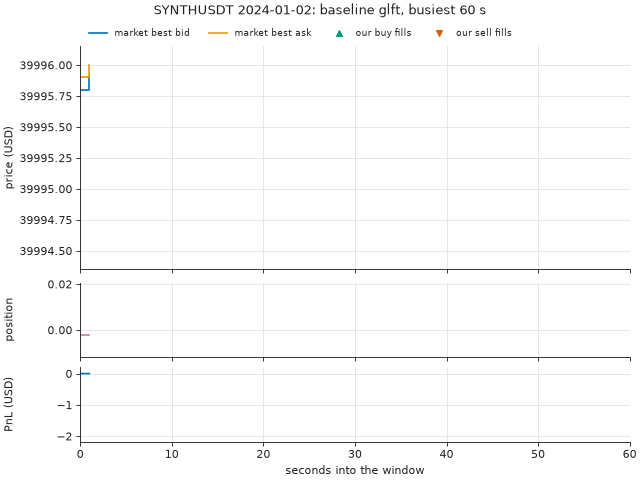
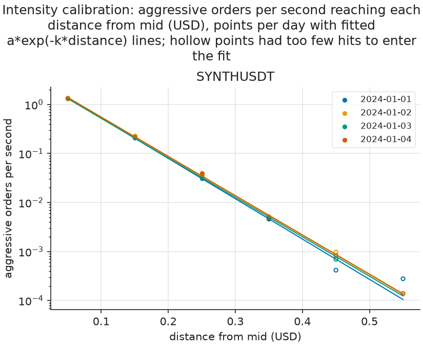
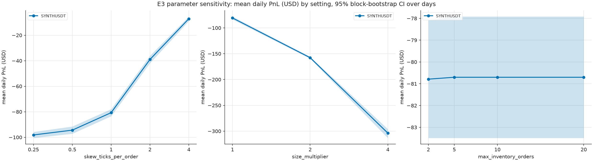
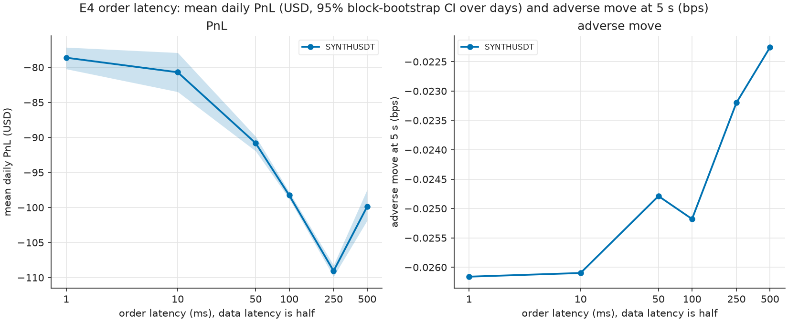
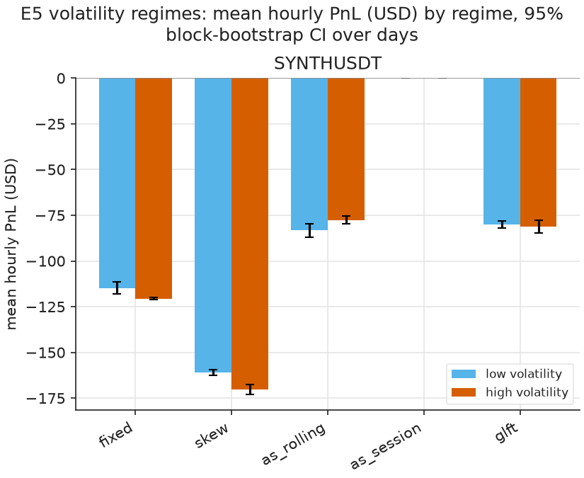
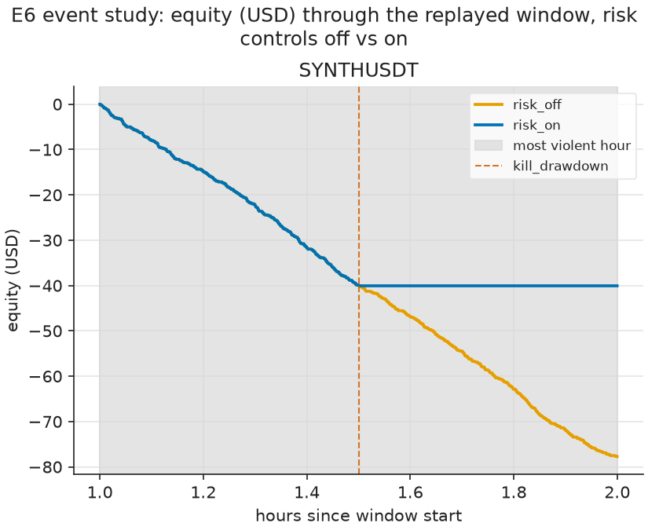
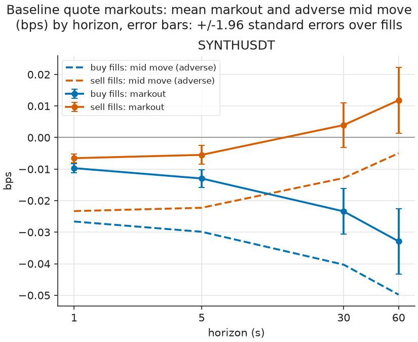

# QuoteLab results: synthetic data

Seeded synthetic order flow for `SYNTHUSDT`: 5 sessions of 1 hour(s) from seed 7. Each session runs with parameters calibrated on the session before it, which leaves 4 test sessions. The generator's parameters are chosen, not fitted to a market, so these numbers test the pipeline and say nothing about real trading.

142 experiment jobs ran as 98 distinct backtests: jobs whose configuration is identical (the E1 `queue_latency` rung, the E2 `glft` strategy, the E4 baseline latency and the E7 baseline) share one run.

Values in brackets are 95% block-bootstrap intervals of the mean over test days, resampling whole days. With 4 test days per cell they are crude: read them as a rough range, not as a significance test. With one day there is no interval.

Everything here is a simulation with an estimated queue position, no market impact and a single venue. Nothing in it is evidence that a strategy would make money live, and none of it is investment advice.

## Contents

- [Replay of the baseline run](#replay)
- [Calibration](#calibration)
- [E1 · Realism ladder](#e1)
- [E2 · Strategy comparison](#e2)
- [E3 · Parameter sensitivity](#e3)
- [E4 · Latency](#e4)
- [E5 · Volatility regimes](#e5)
- [E6 · Event study](#e6)
- [E7 · Fee tiers](#e7)
- [Markouts](#markouts)
- [Run cost](#cost)

## Replay of the baseline run

`SYNTHUSDT` on 2024-01-02, baseline `glft` (the `queue_latency` rung of E1): the 60 seconds of the day with the most quote fills, drawn from the run's own files. Top: the market's best bid and ask with our buy and sell fills; the bid and ask are the run's once-a-second samples, so a fill between two samples can sit outside them. Middle: our position. Bottom: the PnL since the window opened.

## Calibration

`sigma` is the root mean square of one-second mid changes in USD per √s. `A` and `k` come from an ordinary least-squares fit of ln λ(δ) = ln A − kδ, where λ(δ) is the number of aggressive orders per second whose deepest print reached δ USD past the mid just before them, both sides pooled; levels with fewer than 30 hits are left out of the fit. `ofi_beta` is the slope of the next second's mid change on the normalised order-flow imbalance of the trailing window.

`SYNTHUSDT`, 4 calibration days: sigma 0.1110 to 0.1173 USD/√s. k averaged 1.860 per tick of 0.1 USD, so the fitted hit rate falls by a factor of e every 0.5 ticks; R² 0.998 to 1.000 over 4 distance levels. The first level, the touch, carried 83.3 to 84.3% of all hits, and its measured rate was 1.0 times the fitted curve there. The OFI slope averaged 0.0384 USD per unit of imbalance with R² at most 0.29%: that is the most of the next second's mid variance the imbalance explained on any day.

**Calibration per day (each is used to run the following day)**

| Symbol | Calibrated on | sigma (USD/√s) | sigma, klines | A (1/s) | A s.e. | k (1/USD) | k s.e. | R² | Levels | Touch share of hits | OFI beta (USD) | OFI R² |
|---|---|---|---|---|---|---|---|---|---|---|---|---|
| SYNTHUSDT | 2024-01-01 | 0.1110 | n/a | 3.506 | 0.100 | 18.938 | 0.124 | 1.000 | 4 | 84.3% | 0.0439 | 0.0025 |
| SYNTHUSDT | 2024-01-02 | 0.1160 | n/a | 3.507 | 0.216 | 18.437 | 0.269 | 1.000 | 4 | 83.3% | 0.0496 | 0.0029 |
| SYNTHUSDT | 2024-01-03 | 0.1119 | n/a | 3.339 | 0.053 | 18.550 | 0.070 | 1.000 | 4 | 84.3% | 0.0303 | 0.0012 |
| SYNTHUSDT | 2024-01-04 | 0.1173 | n/a | 3.515 | 0.414 | 18.482 | 0.514 | 0.998 | 4 | 83.5% | 0.0296 | 0.0011 |

## E1 · Realism ladder

The same `glft` strategy, calibration and days under five fill and latency assumptions. `optimistic`: any touch of our price fills the whole order. `trade_through`: only a trade strictly through our price fills it. `queue`: the lots queued ahead of us, estimated from top-of-book sizes, must trade away first. These three have no latency. `queue_latency` adds 5 ms market-data and 10 ms order latency and is the baseline of every other experiment. `queue_latency_stress` is the adverse-selection stress: `alpha` = 0, so no unexplained drop in size at our price counts as a cancellation ahead of us, and `participation` = 0.5, so only that share of the volume traded at our price reaches our queue. The rungs are not nested bounds on fills: with latency a quote keeps its old price until the trader's update or cancel arrives, and it can fill in that window, so a latency rung can fill more often than `optimistic`.

`SYNTHUSDT`: mean daily PnL -$289.49 under `optimistic` and -$74.26 under `queue_latency_stress`, a difference of $215.23 a day. Change at each step: `trade_through` $254.97, `queue` -$44.10, `queue_latency` -$2.08, `queue_latency_stress` $6.44. The largest single drop came at `queue` (-$44.10). Before maker fees the first and last rungs made $0.66 and -$0.54; maker fees contributed -$80.26 a day to the baseline on $401,283.81 of maker volume. Quote fills went from 3,627 to 980 a day.

What this can say: how much of the simulated PnL rests on each fill assumption, with everything else held fixed. What it cannot say: which rung is right. With top-of-book data the queue ahead of us is never observed, so `queue` is an estimate and the stress rung is an assumption about it, not a measurement. No rung models the market impact of our own orders, and the ladder only brackets reality if reality lies between the rungs, which this data cannot show.

**E1 realism ladder (USD per day unless stated)**

| Rung | Symbol | Days | Mean daily PnL [95% CI] | Change vs previous rung | PnL before maker fees | Quote fills | Adverse 5 s (bps) |
|---|---|---|---|---|---|---|---|
| optimistic | SYNTHUSDT | 4 | -289.49 [-294.52, -282.39] | n/a | 0.66 | 3,627 | -0.01 |
| trade_through | SYNTHUSDT | 4 | -34.52 [-36.52, -32.52] | 254.97 | -0.36 | 427 | -0.04 |
| queue | SYNTHUSDT | 4 | -78.62 [-80.33, -76.92] | -44.10 | -0.41 | 1,078 | -0.03 |
| queue_latency | SYNTHUSDT | 4 | -80.70 [-83.49, -77.91] | -2.08 | -0.45 | 1,109 | -0.03 |
| queue_latency_stress | SYNTHUSDT | 4 | -74.26 [-75.30, -73.27] | 6.44 | -0.54 | 980 | -0.03 |

## E2 · Strategy comparison

`fixed` quotes 0.5 tick(s) either side of fair value whatever the inventory; `skew` adds a linear skew of 1 tick(s) per order held; `glft` is the Guéant–Lehalle–Fernandez-Tapia closed form with γ back-solved from 1 tick(s) of skew per order held. `as_rolling` is Avellaneda–Stoikov with a constant horizon chosen so that it quotes like GLFT at the calibrated sigma; `as_session` takes the time left until 00:00 UTC as its horizon. Fair value is the `microprice` plus the OFI signal for all of them. PnL is split into spread (half-spread earned against the mid at each fill), inventory (mark-to-market of the position held), fees, hedging and funding; the five add up to the final equity of every run.

`SYNTHUSDT`: highest mean daily PnL `as_session` $0.00, lowest `skew` -$165.62. For `glft` the day splits into spread $0.69, inventory -$1.14, fees -$80.26, hedging $0.00 and funding $0.00. `as_session` had no quote fills on any test day. With the session horizon the A–S spread term γΔσ²τ is wide for most of the day, so `as_session` quotes far from the touch and trades least. A quote that would cross the opposite touch is moved back to the touch (post-only clamp); share of quote updates clamped: `as_session` 0.0%, `as_rolling` 2.5%, `glft` 2.4%, `fixed` 0.0%, `skew` 15.8%.

**E2 strategies (USD per day)**

| Strategy | Symbol | Mean daily PnL [95% CI] | Spread | Inventory | Fees | Hedging | Funding | Quote fills | Clamped to touch | Adverse 5 s (bps) | Mean \|position\| (base units) |
|---|---|---|---|---|---|---|---|---|---|---|---|
| fixed | SYNTHUSDT | -117.67 [-120.60, -113.50] | 0.94 | -1.91 | -116.70 | 0.00 | 0.00 | 1,537 | 0.0% | -0.03 | 0.0486 |
| skew | SYNTHUSDT | -165.62 [-170.38, -161.02] | 1.18 | -1.81 | -164.99 | 0.00 | 0.00 | 2,387 | 15.8% | -0.02 | 0.0046 |
| as_rolling | SYNTHUSDT | -80.44 [-85.09, -76.45] | 0.69 | -1.12 | -80.01 | 0.00 | 0.00 | 1,101 | 2.5% | -0.03 | 0.0034 |
| as_session | SYNTHUSDT | 0.00 [0.00, 0.00] | 0.00 | 0.00 | 0.00 | 0.00 | 0.00 | 0 | 0.0% | n/a | 0.0000 |
| glft | SYNTHUSDT | -80.70 [-83.49, -77.91] | 0.69 | -1.14 | -80.26 | 0.00 | 0.00 | 1,109 | 2.4% | -0.03 | 0.0034 |

## E3 · Parameter sensitivity

One GLFT parameter at a time, everything else at the baseline. Risk aversion is set through the skew it implies per order held, 0.25, 0.5, 1, 2, 4 ticks (baseline 1), and γ is back-solved from it. Order size is the baseline order times 1, 2, 4. The inventory limit is 2, 5, 10, 20 orders (baseline 10).

`SYNTHUSDT`: across skews, mean daily PnL ranged from -$98.16 at 0.25 ticks to -$7.07 at 4. Order size ×1 to ×4 moved it from -$80.70 to -$303.78. γ went from 2,311.9882 to 577.9970: it is back-solved for the same skew per order, so a larger order implies a different γ, and this row mixes a size change with a risk-aversion change. Inventory limits from 2 to 20 orders gave mean daily PnL from -$80.79 to -$80.70.

**E3 sensitivity (USD per day)**

| Parameter | Value | Symbol | Mean daily PnL [95% CI] | Quote fills | Mean \|position\| (base units) | Max drawdown | γ |
|---|---|---|---|---|---|---|---|
| max_inventory_orders | 2.00 | SYNTHUSDT | -80.79 [-83.49, -78.09] | 1,110 | 0.0034 | 80.75 | 2,311.9882 |
| max_inventory_orders | 5.00 | SYNTHUSDT | -80.70 [-83.49, -77.91] | 1,109 | 0.0034 | 80.66 | 2,311.9882 |
| max_inventory_orders | 10.00 | SYNTHUSDT | -80.70 [-83.49, -77.91] | 1,109 | 0.0034 | 80.66 | 2,311.9882 |
| max_inventory_orders | 20.00 | SYNTHUSDT | -80.70 [-83.49, -77.91] | 1,109 | 0.0034 | 80.66 | 2,311.9882 |
| size_multiplier | 1.00 | SYNTHUSDT | -80.70 [-83.49, -77.91] | 1,109 | 0.0034 | 80.66 | 2,311.9882 |
| size_multiplier | 2.00 | SYNTHUSDT | -157.65 [-159.63, -155.68] | 1,166 | 0.0074 | 157.59 | 1,155.9941 |
| size_multiplier | 4.00 | SYNTHUSDT | -303.78 [-313.27, -295.96] | 1,245 | 0.0154 | 303.59 | 577.9970 |
| skew_ticks_per_order | 0.25 | SYNTHUSDT | -98.16 [-100.55, -95.77] | 1,293 | 0.0070 | 98.12 | 215.9941 |
| skew_ticks_per_order | 0.50 | SYNTHUSDT | -94.40 [-97.19, -91.53] | 1,266 | 0.0051 | 94.36 | 761.9619 |
| skew_ticks_per_order | 1.00 | SYNTHUSDT | -80.70 [-83.49, -77.91] | 1,109 | 0.0034 | 80.66 | 2,311.9882 |
| skew_ticks_per_order | 2.00 | SYNTHUSDT | -38.99 [-41.90, -36.08] | 536 | 0.0019 | 38.97 | 6,008.9701 |
| skew_ticks_per_order | 4.00 | SYNTHUSDT | -7.07 [-8.95, -5.33] | 96 | 0.0011 | 7.07 | 14,010.8126 |

## E4 · Latency

Order and cancel latency over 1, 10, 50, 100, 250, 500 ms, with market-data latency half of the order latency. 10 ms is the baseline.

`SYNTHUSDT`: mean daily PnL -$78.62 at 1 ms and -$99.88 at 500 ms, a loss of $21.25 a day. The mid move 5 s after a fill went from -0.03 to -0.02 bps and quote fills from 1,079 to 1,461 a day. PnL did not fall steadily with latency: the lowest mean was -$109.05 at 250 ms.

**E4 latency (USD per day)**

| Order latency (ms) | Symbol | Mean daily PnL [95% CI] | Quote fills | Adverse 5 s (bps) | Markout 5 s (bps) |
|---|---|---|---|---|---|
| 1 | SYNTHUSDT | -78.62 [-80.23, -77.15] | 1,079 | -0.03 | -0.01 |
| 10 | SYNTHUSDT | -80.70 [-83.49, -77.91] | 1,109 | -0.03 | -0.01 |
| 50 | SYNTHUSDT | -90.82 [-91.95, -89.87] | 1,260 | -0.02 | -0.01 |
| 100 | SYNTHUSDT | -98.26 [-98.74, -97.77] | 1,371 | -0.03 | -0.01 |
| 250 | SYNTHUSDT | -109.05 [-109.87, -108.23] | 1,572 | -0.02 | -0.01 |
| 500 | SYNTHUSDT | -99.88 [-101.87, -97.46] | 1,461 | -0.02 | -0.01 |

## E5 · Volatility regimes

Each test-day hour is labelled `high` when the sum of its squared one-second mid changes is above its symbol's median over all test hours, otherwise `low`. The label uses the hour's own data, so this describes where PnL came from; it is not a regime signal a strategy could have traded on. The strategies are the E2 runs.

`SYNTHUSDT` (2 high-volatility hours), mean PnL per hour: `fixed` -$114.74 in low and -$120.60 in high hours; `skew` -$161.02 in low and -$170.22 in high hours; `as_rolling` -$83.31 in low and -$77.58 in high hours; `as_session` $0.00 in low and $0.00 in high hours; `glft` -$80.13 in low and -$81.27 in high hours. The largest fall from calm to volatile hours was `skew`, -$9.21 an hour.

**E5 volatility regimes (USD per hour)**

| Strategy | Symbol | Regime | Days | Hours | Mean hourly PnL [95% CI] |
|---|---|---|---|---|---|
| fixed | SYNTHUSDT | high | 2 | 2 | -120.60 [-121.17, -120.03] |
| skew | SYNTHUSDT | high | 2 | 2 | -170.22 [-173.02, -167.43] |
| as_rolling | SYNTHUSDT | high | 2 | 2 | -77.58 [-79.84, -75.32] |
| as_session | SYNTHUSDT | high | 2 | 2 | 0.00 [0.00, 0.00] |
| glft | SYNTHUSDT | high | 2 | 2 | -81.27 [-84.81, -77.74] |
| fixed | SYNTHUSDT | low | 2 | 2 | -114.74 [-118.16, -111.33] |
| skew | SYNTHUSDT | low | 2 | 2 | -161.02 [-162.46, -159.58] |
| as_rolling | SYNTHUSDT | low | 2 | 2 | -83.31 [-86.88, -79.74] |
| as_session | SYNTHUSDT | low | 2 | 2 | 0.00 [0.00, 0.00] |
| glft | SYNTHUSDT | low | 2 | 2 | -80.13 [-82.17, -78.09] |

## E6 · Event study

Each symbol's most violent hour over all test days (largest sum of squared one-second mid changes) is replayed with 1 hour(s) either side, once with every risk control off and once with all of them on. Kill switches: position beyond 15 orders, drawdown, and no book update for 5 s. Circuit breakers, each pausing quotes for 30 s: 10 s volatility above 4 times the 600 s volatility, spread above 5 bps, |OFI| at least 0.8, and a gap of more than 2 s in market data. Size ramp: 1, 2, 4 times the order size, one step up per 4 hours without a breaker trip. A kill stops quoting for the rest of the run and flattens the position with a taker order.

The drawdown kill fires when equity falls more than `max_drawdown_bps` (100 bps) of the largest allowed position's notional below its peak: 100 / 10,000 × 10 orders × order size × the first mid of the run. That gave $40.00 for `SYNTHUSDT`. The 100 bps is a round number chosen for this project, not calibrated, and the risk-on result depends on it directly.

`SYNTHUSDT` on 2024-01-04: PnL -$77.74 with controls off (max drawdown $77.74) and -$40.06 with controls on (max drawdown $40.06), a gain of $37.68 for the controls. Market data in the window ran from 2024-01-04 00:00 to 2024-01-04 00:59 UTC. `kill_drawdown` fired 30 minutes after the first replayed update (drawdown 40.02 > 40.00 USD). Risk events with controls on: kill_drawdown 1.

`kill_inventory` is set at 15 orders, above the inventory limit of 10 orders, and that limit already stops quoting any side that would take the position past it. The switch is therefore a backstop against a fault in the limit; it fired 0 time(s) here.

**E6 windows**

| Symbol | Test day | Window start (UTC) | Window end (UTC) | Most violent hour (UTC) | Realised variance (USD²) |
|---|---|---|---|---|---|
| SYNTHUSDT | 2024-01-04 | 2024-01-03 23:00 | 2024-01-04 02:00 | 2024-01-04 00:00 | 49.52 |

**E6 risk controls off and on (USD over the window)**

| Symbol | Controls | PnL | Max drawdown | Quote fills | Mean \|position\| (base units) | Risk events | Kill | Drawdown limit | Events by kind |
|---|---|---|---|---|---|---|---|---|---|
| SYNTHUSDT | risk_off | -77.74 | 77.74 | 1,059 | 0.0033 | 0 | none | n/a | none |
| SYNTHUSDT | risk_on | -40.06 | 40.06 | 545 | 0.0016 | 1 | kill_drawdown | 40.00 | kill_drawdown 1 |

## E7 · Fee tiers

PnL at maker fee m is computed from each baseline run as PnL(m) = PnL(base) + (base − m) / 10,000 × maker volume. It is exact when the fills do not depend on the fee, which holds here: no strategy reads the fee and the baseline has no risk layer. Real reruns at 0 bps test that claim. The baseline fees, maker 2 bps and taker 5 bps, are config values that were not checked against Binance's current fee schedule.

`SYNTHUSDT`: over 4 test days the baseline would break even at a maker fee of -0.011 bps, a rebate of 0.011 bps. At -1 bps, the lowest fee in the grid, its mean daily PnL would be $39.68.

4 rerun(s): the largest absolute difference between a rerun's PnL and the formula was 1.6e-12 USD, and 4 of 4 had exactly the baseline's number of quote fills.

**E7 fee tiers (USD per day)**

| Symbol | Maker fee (bps) | Days | Mean daily PnL [95% CI] |
|---|---|---|---|
| SYNTHUSDT | 2.00 | 4 | -80.70 [-83.49, -77.91] |
| SYNTHUSDT | 1.00 | 4 | -40.57 [-41.96, -39.18] |
| SYNTHUSDT | 0.00 | 4 | -0.45 [-0.46, -0.43] |
| SYNTHUSDT | -0.50 | 4 | 19.62 [18.91, 20.33] |
| SYNTHUSDT | -1.00 | 4 | 39.68 [38.28, 41.09] |

**E7 break-even maker fee over all test days**

| Symbol | Total PnL | Total maker volume | Break-even maker fee (bps) |
|---|---|---|---|
| SYNTHUSDT | -322.81 | 1,605,135 | -0.011 |

**E7 reruns against the formula (USD per day)**

| Symbol | Test day | Maker fee (bps) | Rerun PnL | Formula PnL | \|Difference\| | Same fills |
|---|---|---|---|---|---|---|
| SYNTHUSDT | 2024-01-02 | 0.00 | -0.45 | -0.45 | 1.6e-12 | True |
| SYNTHUSDT | 2024-01-03 | 0.00 | -0.43 | -0.43 | 2.4e-13 | True |
| SYNTHUSDT | 2024-01-04 | 0.00 | -0.46 | -0.46 | 5.3e-13 | True |
| SYNTHUSDT | 2024-01-05 | 0.00 | -0.44 | -0.44 | 1.7e-13 | True |

## Markouts

For each fill of the baseline, the markout is side × (mid after h seconds − fill price) / fill price, in bps: positive means the fill was worth more than its price against the later mid, and it includes the half-spread captured. The mid move is side × (mid after h − mid at fill) / fill price: it removes the half-spread and is the adverse-selection measure, negative when the mid moved against the fill. Intervals in the figure are ±1.96 standard errors across fills, which ignores the correlation between nearby fills and is therefore too narrow.

`SYNTHUSDT` at 5 s: buy fills markout -0.01 bps and mid move -0.03 bps (2,210 fills); sell fills markout -0.01 bps and mid move -0.02 bps (2,219 fills).

**Markouts of baseline quote fills, all test days**

| Symbol | Side | Horizon (s) | Fills | Markout (bps) | s.e. (bps) | Mid move (bps) | Total markout (USD) |
|---|---|---|---|---|---|---|---|
| SYNTHUSDT | sell | 1 | 2,223 | -0.007 | 0.001 | -0.023 | -0.65 |
| SYNTHUSDT | sell | 5 | 2,219 | -0.005 | 0.001 | -0.022 | -0.61 |
| SYNTHUSDT | sell | 30 | 2,206 | 0.004 | 0.004 | -0.013 | 0.16 |
| SYNTHUSDT | sell | 60 | 2,190 | 0.012 | 0.005 | -0.005 | 0.81 |
| SYNTHUSDT | buy | 1 | 2,213 | -0.010 | 0.001 | -0.027 | -0.87 |
| SYNTHUSDT | buy | 5 | 2,210 | -0.013 | 0.001 | -0.030 | -1.14 |
| SYNTHUSDT | buy | 30 | 2,196 | -0.023 | 0.004 | -0.040 | -1.95 |
| SYNTHUSDT | buy | 60 | 2,182 | -0.033 | 0.005 | -0.050 | -2.65 |

## Run cost

`SYNTHUSDT`: 98 distinct runs replaying 41,089 market events each on average, at 63,373 events per wall-clock second of simulation; the largest worker peak resident memory was 226 MB.

Times are wall-clock on the machine that produced this report and vary with the machine and its load; they are here to size a rerun, not as a benchmark.

**Run cost**

| Symbol | Runs | Mean events per run | Mean simulation time (s) | Events per second | Total job time (s) | Max worker peak RSS (MB) |
|---|---|---|---|---|---|---|
| SYNTHUSDT | 98 | 41,089 | 0.6 | 63,373 | 76 | 226 |
